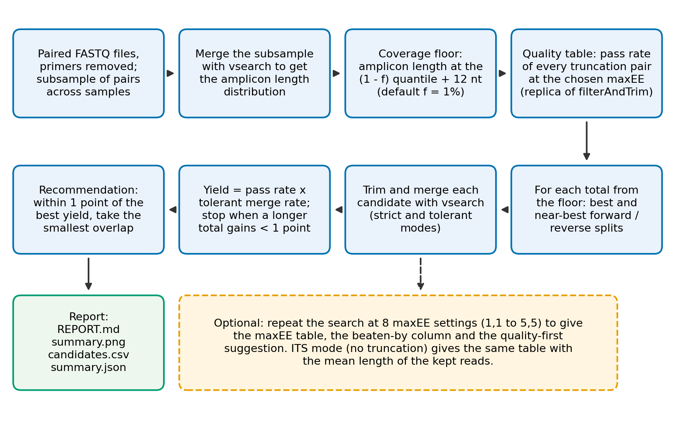

# AmpliTrim: validation findings

This is the validation write-up of AmpliTrim: how each claim of the tool was tested against real DADA2 runs, and what held and what did not. It began as a manuscript draft and is kept here as a record; it has not been submitted anywhere. Every test, with its command, condition and outcome, is in [`TEST_REGISTER.md`](../TEST_REGISTER.md) (sections 1 to 13); the scripts are in [`validation/`](../validation/README.md). The first four rounds of development and validation (mock community A, the coverage rule, ITS, simulations) are in [`SUPPLEMENT.md`](SUPPLEMENT.md). Their numbers were obtained under earlier builds and defaults; where this document reports the same quantity from the fresh runs, the fresh runs apply.

The results below come from two runs of the whole validation set on 12 datasets: night 1 (build `6b0c25b6e3`: the standard battery, one default setting for every dataset) and night 2 (build `b8469465fc`: the maxEE head-to-head). Four cautions. The reference list was written from memory and has not been checked. The figures of the earlier drafts have not been regenerated, so this version has tables only (Figure 1 is the workflow). The swab samples were chosen by a fixed automatic rule (section 3). Several arms and thresholds proposed after night 2 are labelled post hoc.

## Abstract

**Background.** DADA2 asks the user to choose truncation lengths for the forward and reverse reads, and a limit on expected errors (maxEE). Truncating too little leaves low-quality tails that fail the expected-error filter. Truncating too much leaves too little overlap, and the longest amplicons can no longer be merged. Guidance is mostly visual (quality plots), and the one automatic tool, FIGARO, needs reads of one length, takes one amplicon length from the user and cannot be used for variable-length amplicons such as ITS.

**Methods.** AmpliTrim reproduces DADA2's quality filter from per-read expected errors, sets a coverage floor from the amplicon lengths measured in the reads, and estimates the yield of each candidate setting by merging the reads that pass. We tested it against real DADA2 runs on 12 datasets (six mock communities, four of them with expected sequences, and six real datasets), with the criteria and the comparisons written into a register before each run, in one build and one default setting, and with mock and real data reported apart. FIGARO was run at the same 12 nt minimum overlap.

**Results.** AmpliTrim predicted the share of pairs passing DADA2's filter to within 0.8 points on all 12 datasets (FIGARO's predicted retention was off by up to 7.7 points). Its yield estimate ranked settings in DADA2's order on 9 of the 11 datasets where it was ranked (0.90 and 0.80 on the others) but overshot the merged share by -2 to +7 points on ten datasets and by +21 and +32 points on ITS and soil V4. At the same maxEE, AmpliTrim's cuts and FIGARO's merged within 2.6 points of each other (the same on five datasets; mean +0.4 points in AmpliTrim's favour), so the remaining difference is the maxEE: FIGARO picks 1 on clean reads and 4 to 9 on poor ones. AmpliTrim's default of 2 merged 2.3 to 6.3 points more pairs than FIGARO on six clean datasets (for 0.01 to 0.10 more expected errors per read) and 15 to 54 points fewer on four poor-quality datasets. None of three AmpliTrim rules for choosing maxEE (a quality-first pick at two retention floors, and a FIGARO-like rule) matched FIGARO's pick across datasets (0, 0 and 4 matches in 10 datasets). A looser maxEE cost no accuracy on any mock community and raised it on one. FIGARO's result depends on the amplicon length it is given: at the typical length it merged 25 to 54% on four datasets where the longest length gave 67 to 94%, and at the longest length it failed on one. Leaving out the longest 1% of amplicons raised one mock community from 57% to 90% merged pairs and cost none of six datasets anything. Relaxing the reverse limit to DADA2's suggested maxEE (2,5) merged 7.5 to 29.8 points more pairs on the five datasets where the default kept under 70% of the pairs, without losing accuracy on four mock communities, but left AmpliTrim 16 and 24 points behind FIGARO's pick on wastewater and mock B; a careful manual cut never beat AmpliTrim's at the same maxEE.

**Conclusions.** AmpliTrim's truncation recommendations are equivalent to FIGARO's at the same maxEE, its predictions are more accurate, it uses all read pairs, and it shows what each choice costs. Its weakness is the default maxEE, which is too strict for poor-quality reads; none of the automatic rules we tested matched FIGARO's choice, and DADA2's own relaxation to (2,5) closed only part of the gap, so maxEE is left to the user, with the alternatives shown. The level of the yield estimate on rich real samples, and accuracy in them, remain unmeasured.

**Keywords:** DADA2; truncLen; maxEE; amplicon sequencing; 16S rRNA; ITS; paired-end reads; quality filtering

## 1. Introduction

DADA2 infers exact sequence variants from paired Illumina amplicon reads, and its standard workflow asks the user to choose how many bases to keep from each read (truncLenF and truncLenR) \[1\]. The choice has two competing effects. Truncating removes the low-quality tails of the reads, so more pairs pass the expected-error filter (maxEE) \[3\]. But the truncated reads must still overlap by at least the merge minimum (12 nt by default) across the whole amplicon. Every nucleotide removed shortens the amplicons that can be merged, and once the total kept falls below the longest amplicon plus 12 nt, that amplicon is lost. Amplicons within one study are not one length: the 15 strains of one mock community had V1-V3 amplicons from 460 to 523 nt, and ITS amplicons differ by hundreds of nucleotides.

Current practice is to read the quality plots and truncate where the curves fall, with a margin for overlap. FIGARO searches truncation pairs for the best retention under a read-quality model \[2\], but it expects reads of one length; after primer removal reads are of mixed lengths, and in our datasets FIGARO could use between 8% and 98% of the pairs. It does not apply to ITS, where the DADA2 ITS workflow advises against truncation \[5\]. The choice is therefore often made by habit and not tested on the data. A poor choice is easy to miss because DADA2 reports no error: pairs are lost quietly, and long amplicons that cannot merge look like taxa that are absent.

AmpliTrim treats truncation as a measurement. It evaluates DADA2's own filter on every candidate setting directly from the reads' quality scores, derives the coverage floor from the amplicon lengths in the reads, estimates the merge yield with vsearch \[4\], and reports the trade-off in tables and figures so that the user decides. It does not replace DADA2, and it changes maxEE only when asked.

Here we describe AmpliTrim and test each of its claims against real DADA2 runs. We ask whether its filter prediction matches DADA2's; whether its yield estimate ranks settings correctly and how far it is from the share DADA2 merges; how its choices compare with FIGARO and with fixed settings; whether its coverage rule predicts which taxa are lost, in a mock community; what maxEE costs and buys in retention and accuracy; and whether AmpliTrim, choosing maxEE itself, ends up where FIGARO does. We report the claims that did not hold as well as those that did.

## 2. Implementation

AmpliTrim is a Python package with a command-line interface. It reads a folder of paired FASTQ files whose primers have been removed, and writes a report (REPORT.md), a three-panel figure (summary.png), a table of every candidate tested (candidates.csv) and a machine-readable summary (summary.json). Its steps are shown in Figure 1.

**Figure 1. The AmpliTrim workflow.** Solid boxes are always run. The dashed box is optional (--explore-max-ee); in ITS mode (no truncation) the maxEE table is the main output.

**2.1 Amplicon lengths and the coverage floor.** A subsample of pairs, spread evenly across samples, is merged with vsearch \[4\] from the full-length reads (minimum overlap 12, staggered pairs allowed). The merged insert lengths (the length of the sequence between the two primers, which this paper also calls the amplicon length) give the distribution of amplicon lengths. The coverage floor is the shortest total length (truncLenF + truncLenR) at which all but a chosen share of the amplicons can still be merged with DADA2's minimum overlap of 12 nt, which is its default: an amplicon of length L needs a total of at least L + 12. The 12 nt is assumed and was not varied in the real-data validation; in mock community A we saw no sign of false joins at this overlap, and a simulation with known truth found none either unless a long perfect repeat lay across the overlap (section 4.9). By default the longest 0.2% of amplicons may be left out (--allow-unmergeable; the development rounds in the supplement used 1%, which was the default until the coverage rule of its section 4.4 was met, and night 1 and night 2 used 0.2%), and the share left out is always reported.

**2.2 The quality table.** From the Phred scores, each read has a cumulative expected-error profile, EE = sum of 10^(-Q/10) over its bases. For any truncation pair and maxEE, AmpliTrim applies the rule of DADA2's filterAndTrim: a read is cut at its first base with quality 2 or lower (truncQ = 2), pairs containing an N or a read shorter than its truncation length are discarded, and a read passes if its expected errors, counted over the truncated read, do not exceed maxEE (one value, or one for each read as in maxEE = c(F, R)). Evaluating this for every pair in one pass gives a table of pass rates over the whole grid of truncation pairs. In development the table was checked against filterAndTrim on the DADA2 example reads (200 settings, identical results) and on simulated communities (supplement, TEST\_REGISTER.md, S1 to S3).

**2.3 Candidate search and yield.** Starting at the coverage floor, AmpliTrim steps up the total length. For each total it takes the best and near-best forward/reverse splits from the quality table (and, optionally, FIGARO's proposals). Each candidate is trimmed and merged with vsearch in two modes: strict (the number of mismatches DADA2 allows, applied to the raw reads) and tolerant (vsearch's default allowance), which better approximates DADA2 merging after denoising has corrected the reads. The estimated yield is the share of pairs that pass the filter multiplied by the tolerant merge rate. The search stops when a longer total improves the yield by less than one percentage point, or when the full reads are reached.

**2.4 Recommendation.** Among the candidates that cover the amplicon range, those whose yield is within one percentage point of the best are treated as tied, and the one with the smallest overlap is chosen. Overlaps within 2 nt count as equal, and further ties go to the higher yield, the more balanced split, and the fewest observed mismatches per overlap base. Less overlap is preferred because it relies less on the noisy ends of the reads.

**2.5 maxEE.** AmpliTrim does not change maxEE (default 2, DADA2's value). On request (--explore-max-ee) it finds the best truncation for each of eight maxEE settings (from 1,1 to 5,5) and reports, for each, the pass rate, the estimated yield, the expected errors per kept pair, and the expected errors in the pairs that a looser limit adds beyond maxEE 2. A setting is called beaten if another keeps more pairs with fewer expected errors per pair; the two are never combined into a score. A quality-first suggestion is the least noisy setting that is not beaten and keeps at least a chosen share of pairs (--min-retention, default 50%); it never goes below DADA2's default of 2.

**2.6 ITS mode.** For amplicons that vary in length (--marker its) AmpliTrim does not truncate, which is the DADA2 ITS workflow \[5\]. Each read is cut at its first base with quality 2 or lower, and the report gives, for each maxEE, the pass rate, the estimated yield, the mean length of the kept reads and their expected errors, with the same beaten-by and quality-first rules as for 16S.

**2.7 Pre-processing, validation scripts and quality assurance.** For the validation, primers were removed with cutadapt \[6\] in two passes: a strict pass (at least 8 bases) that finds the primers and discards pairs without them, and a lenient pass (at least 3 bases) that removes read-through only. With a single pass and a minimum overlap of 3, chance matches let 3,126 of 3.09 million pairs (0.10%) through without trimming. This was found during the validation and fixed by using two passes. The validation scripts run real DADA2 for each method on the same reads (compare\_methods.py, max\_ee\_sweep.py, mockA\_dilutions.py, overnight.py) and score the output against expected sequences with vsearch (mock\_check.py). The package has 262 automated tests, including recomputation of filter results in plain Python and comparison with filterAndTrim output, and every command prints a build identifier so that a result can be tied to the code that produced it.

## 3. Validation design

Every claim was tested by running real DADA2 on the same reads under each method and comparing its output with AmpliTrim's prediction. The criteria, arms, margins and verdict words were written into `TEST_REGISTER.md` before each run: sections 1 to 9 for the development rounds (supplement), section 11 for night 1 (the standard battery on every dataset, in one build and with one default, `--allow-unmergeable` 0.2%) and section 12 for night 2 (the maxEE head-to-head). The run script wrote a protocol note listing the datasets, their roles and the rules before any analysis. The datasets were not blinded: mock community A and soil V4 were used in development, and the others were held out. Mock communities and real samples are reported apart, because the first have few taxa and known composition and the second are diverse and have no truth.

**Table 1. Datasets and their roles.**

| Dataset | Marker, region, platform | Samples | Truth | Role |
| --- | --- | --- | --- | --- |
| Mock community A, PRJEB67797 \[7\] | 16S, V1-V3 (27F-YM/534R), MiSeq 2x300 | 6 high-input samples for the settings (23 in the dilution series) | the authors' ASVs anchored to Sanger sequences of 14 of 15 strains (not independent) | development |
| Mock community B, PRJEB67827 \[7\] | 16S, V1-V3, MiSeq 2x300 | 8 | Zymo reference sequences (three species, 7 variants; independent) | held out |
| Inter-laboratory mock, V1-V2, PRJEB34919 \[10\] | 16S, V1-V2 (about 337 bp), MiSeq 2x300 | 6 | none (15 bacteria; digital PCR family abundances only) | held out |
| Inter-laboratory mock, V4-V6, PRJEB34919 \[10\] | 16S, V4-V6 (about 564 bp), MiSeq 2x300 | 5 of 6 | none | held out (real tight overlap) |
| ZymoBIOMICS D6300, V3-V4, PRJNA1261676 | 16S, V3-V4 (341F/805R), NovaSeq 6000, 2x250, primers removed by the submitter, binned qualities | 10 | Zymo reference sequences (8 bacteria) | held out |
| ZymoBIOMICS D6300, V4-V5 | 16S, V4-V5 (515F/926R), MiSeq 2x300 | 3 | Zymo reference sequences | held out (source study not identified) |
| PRJEB42528 | 16S, V1-V2 (27F/338R), MiSeq 2x300 | 33 | none | held out |
| PRJNA574030 | 16S, V4 (reads of 207 nt after trimming; platform to confirm) | 36 soil samples | none | development |
| PRJEB58189 \[8\] | ITS (ITS1-Fl2/ITS2), MiSeq 2x250 | 37 spring-wheat samples | none | case study (FIGARO cannot be run) |
| PRJEB75155 | 16S, V3-V4 (341F/805R), MiSeq; trimmed reads of mixed length; every pair in reverse orientation | 9 wastewater samples | none | held out |
| PRJNA1243306 | 16S, V3-V4, NovaSeq 6000, 2x250, binned qualities; mouse gut with synthetic spike-ins | 12 | spike-in sequences not available, so not used | held out |
| Swabs of meat-processing surfaces, PRJNA1261676 | 16S, V3-V4, NovaSeq 6000 (the run that holds the D6300 V3-V4 mock) | 36 of 371 eligible runs | none | held out |

Datasets that were examined and not used: PRJNA971391 (V4-V5; the quality scores took only two distinct values and ENA holds no original files), one D6300 run with two distinct quality values, one D6300 run that was shotgun metagenomic data despite its label, and a skin dataset (another real V1-V3 set would add little). The swab samples were chosen by a fixed rule: paired NovaSeq runs of the project with at least 20,000 reads whose own labels did not match mock or control patterns, evenly spaced over the sorted accessions; samples under 5,000 pairs were dropped at preparation. Primers were removed with cutadapt as in section 2.7; the V3-V4 reads of the D6300 and swab runs had none left, and the wastewater pairs were all in the reverse orientation and were handled with the mixed-orientation option.

**DADA2 runs.** filterAndTrim (truncLen, maxN = 0, maxEE, truncQ = 2, minLen, rm.phix = FALSE); learnErrors for each read direction; dada with per-sample inference; mergePairs (minOverlap 12, maxMismatch 0); makeSequenceTable; removeBimeraDenovo (consensus). DADA2 1.40.0 (R 4.6.1), vsearch 2.32.0 and cutadapt 5.2 (Python 3.12, Windows). Large datasets were thinned to a set number of pairs per sample for DADA2 (5,000 pairs per sample unless stated); where full depth was used, it is stated. In night 2, mock community A (high input) was run at full depth.

**The comparison with FIGARO.** FIGARO (the `figaro-master` copy on the author's machine) was run with its minimum overlap set to 12 nt, equal to AmpliTrim's and to DADA2's `mergePairs` default, with no primer lengths (the primers were already removed), on the pairs whose reads have the most common lengths (it needs reads of one length; the share of pairs it saw is given per dataset in the results), and with the amplicon length it needs given as the longest amplicon AmpliTrim measured and, in night 2, also as the typical (median) length on datasets with a tail of longer amplicons. FIGARO's truncation and maxEE were used for DADA2 as it printed them. A FIGARO failure is reported as 'no result' and not as a difference in outcome. FIGARO at its own default overlap was not run.

**Table 2. The arms of night 2.**

| Arm | Truncation | maxEE |
| --- | --- | --- |
| A | AmpliTrim's recommendation | 2 (DADA2's default) |
| B | AmpliTrim's best for that maxEE | AmpliTrim's quality-first pick (`--explore-max-ee`, floor of 50% of pairs, never below 2) |
| B2 | as B | as B with a floor of 80% |
| B4 | as B | the mean expected errors of the reads at the cut, plus one, rounded (an approximation of FIGARO's rule) |
| C | FIGARO's | FIGARO's, at the longest amplicon length (C) and at the typical length (C typical) |
| D | AmpliTrim's best for that maxEE | FIGARO's (control) |
| E | none | 2 |
| F | where the median quality first falls below 30 | 2 |

**Measures.** Pass rate: the share of input pairs passing filterAndTrim. Merged: the share of input pairs merged by DADA2 (after denoising). Yield estimate: AmpliTrim's pass rate multiplied by its tolerant merge rate, to be compared with the merged share. For mock communities, each ASV was matched to the expected sequences with vsearch and classed as identical (exact match to part of an expected sequence), near (at least 99% identity, about 4 to 5 bases over 470 nt, the rule of the paper that defined the reference \[7\]) or none. Variants and strains recovered were counted against the variants present in the samples analysed.

**Verdicts (night 2).** Two picks are the same on the merged share inside 2.0 points; they are equally noisy when both reads' expected errors per kept read, measured at the arm's cut and maxEE, are within 0.02. Against FIGARO's pick an arm is *better* (a gain on one axis and no loss on the other), *worse*, *matches*, a *trade-off* (more pairs but noisier, or fewer pairs but cleaner), *mixed noise*, or *no result*. On mock communities accuracy (variants, strains, reads in exact ASVs, with margins of 1, 1 and 0.1 points) is shown beside the verdict and decides a disagreement. No winner is declared on real data unless one pick is better on both axes. Datasets with fewer than 10 samples are reported as point estimates.

**Criteria and predictions.** Night 1 applied the standard battery of the register (section 3): the filter pass rate predicted within 2 points; the yield estimate ranking settings in DADA2's order; and AmpliTrim equal to FIGARO at FIGARO's maxEE, within a margin of 1.0 point of merged pairs. The question of night 2 was whether AmpliTrim, choosing its own maxEE, ends up where FIGARO ends up. Five predictions were written before the run (P1 to P5, Table 10).

**Statistics.** Differences between methods are paired per sample, reported as the mean with a bootstrap 95% interval over samples, and only when there are at least 10 samples; for the six-sample datasets (mock community A and the inter-laboratory mock) the interval is printed but is a bootstrap over six samples and is not reliable. No multiple-comparison correction was applied because the comparisons are descriptive. In night 2, datasets with fewer than 10 samples are reported as point estimates.

**Further analyses.** ASVs that were not identical to an expected sequence were classified, in this order, as contaminants (identical to, or within 2 edits of, an ASV that the authors' table finds in its negative controls, the columns named NK and Wasser), chimeras (flagged by vsearch uchime\_denovo, or by uchime\_ref against the expected sequences, with parents that differ from each other by at least 0.5%), error variants (within 3 edits of an ASV at least 5 times as abundant, or of an expected sequence), unlisted variants (97 to 99.9% identical to an expected sequence) or unexplained. For the coverage levels, AmpliTrim was run with 1%, 0.5%, 0.2%, 0.1% and 0% of the longest amplicons allowed to be left out, and DADA2 at each distinct truncation. For the landscape, DADA2 was run on a 5 x 5 grid of truncations in steps of 10 nt around AmpliTrim's recommendation, and the regret is the merged share of the best setting that meets the coverage floor minus that of the recommendation. To trace a missed variant, the full-length reads of its dilution were merged with vsearch before any filtering, and the reads identical to it, or within 1 or 2 edits of it, were counted, together with the nearest ASV. To ask whether a maxEE rule could match FIGARO's, the pass rate and the mean expected errors per kept read were computed with AmpliTrim's exact quality table (no DADA2) for FIGARO's own settings and, at AmpliTrim's truncation, for every maxEE of a grid (forward 1 to 6, reverse 1 to 9), on 60,000 pooled pairs per dataset.

## 4. Results

### 4.1 The filter is predicted within 0.8 points; the yield estimate ranks settings but overshoots

AmpliTrim's estimate of the share of pairs passing DADA2's filter was within 0.8 points of the measured pass rate on all 12 datasets (mean absolute error 0.2 points; Table 3), on mock communities and real samples alike. FIGARO's predicted retention at its own pick was off by 0.2 to 7.7 points, and by most where it saw few pairs (swabs +7.7 with 9% of the pairs, spike-in +3.4 with 25%, wastewater -3.3 with 61%). The estimated yield ranked the settings in DADA2's order on 9 of the 11 datasets where a rank was printed (correlation 1.00); it did less well on mock A (0.90) and wastewater (0.80).

**Table 3. Prediction by AmpliTrim, night 1.** Filter error: AmpliTrim's estimated pass rate minus DADA2's, averaged over the settings. Yield excess: the estimated yield minus the share DADA2 merged (mean and range over the settings). FIGARO error: its predicted retention minus DADA2's pass rate.

| Dataset | Kind | Samples | Filter error | Yield excess | Rank correlation | FIGARO error |
| --- | --- | --- | --- | --- | --- | --- |
| Mock community A (high input) | mock | 6 | -0.8 | +2.7 (+0.3 to +4.2) | 0.90 | -0.4 |
| Mock community B | mock | 8 | +0.1 | -2.2 (-6.7 to +1.1) | 1.00 | +2.9 |
| Inter-laboratory V1-V2 | mock | 6 | -0.1 | +0.3 (-0.1 to +0.4) | 1.00 | +0.2 |
| Inter-laboratory V4-V6 | mock | 5 | -0.2 | -1.6 (-3.8 to +0.4) | 1.00 | +0.9 |
| D6300 V3-V4 | mock | 10 | +0.1 | +2.9 (+2.3 to +3.2) | 1.00 | +0.6 |
| D6300 V4-V5 | mock | 3 | +0.2 | +6.7 (+5.6 to +8.0) | (3 settings) | no result |
| V1-V2 | real | 33 | 0.0 | +6.5 (+6.3 to +6.8) | 1.00 | -0.4 |
| Soil V4 | real | 36 | 0.0 | +32.1 (+31.0 to +32.9) | 1.00 | +1.9 |
| ITS | real | 37 | +0.1 | +21.1 (+13.7 to +30.4) | 1.00 | cannot be run |
| Wastewater V3-V4 | real | 9 | +0.2 | +3.9 (-2.1 to +7.2) | 0.80 | -3.3 |
| Spike-in V3-V4 | real | 12 | -0.5 | +3.4 (+2.9 to +3.7) | 1.00 | +3.4 |
| Swabs V3-V4 | real | 36 | -0.1 | +7.0 (+6.7 to +7.2) | 1.00 | +7.7 |

The yield estimate stops before denoising and was optimistic on most datasets: by -2.2 to +6.7 points on the six mock communities, by +3.4 to +7.0 on four real datasets (wastewater, spike-in, V1-V2, swabs), and by +21.1 and +32.1 points on ITS (5,000 pairs per sample) and soil V4. In simulations with known truth the excess rose with the number of taxa, from -1.4 points at 25 taxa to +4.4 at 1,000, which explains only a small part of the soil V4 value (supplement). The hypothesis that tolerance for mismatches in the overlap causes the overshoot was rejected: the strict estimate, which allows none, still overshot soil V4 by +25.0 points. The cause is unexplained. When settings differed in how much of the long-amplicon tail they covered, the estimate ranked soil V4 poorly (rank correlation +0.09 over seven settings in night 2).

### 4.2 At the same maxEE the two tools choose nearly the same cuts

Given the same maxEE, AmpliTrim's truncation and FIGARO's gave the same merged share on five datasets, and differed by 0.3 to 2.6 points on five others (Table 4; the control arm D of night 2). AmpliTrim was ahead on four (mock B +2.6, spike-in +1.3, V1-V2 +1.1, inter-laboratory V4-V6 +0.3), tied on five and behind on one (wastewater -1.0); the mean over the ten datasets was +0.4 points. Only mock B (+2.6) lies beyond the 2-point margin of night 2 (in night 1, with a margin of 1.0, mock B and spike-in were beyond it in AmpliTrim's favour and wastewater against it), so this is evidence that the cuts are equivalent, not that they are better. The total length (forward plus reverse) was the same on seven of the ten datasets and within 6 nt on the other three; the split between the reads differed by up to 14 nt (V1-V2, forward 225 against 211). Wastewater has the largest difference in total: at maxEE 5 AmpliTrim chose a cut 6 nt longer than FIGARO's (446 against 440 nt) because its yield estimate rewarded the extra overlap (72.9% predicted for its own cut against 64.6% for FIGARO's; DADA2 gave 65.7% and 66.7%); the extra length cost 0.9 points at the filter, and the share of passed pairs that merged was the same within 0.4 points. At maxEE 2 its total there was 440, the same as FIGARO's.

**Table 4. AmpliTrim's cut at FIGARO's maxEE against FIGARO's pick (arm D), night 2.** Difference in the share of pairs DADA2 merged, in points; the interval (bootstrap, 95%) is given only for 10 or more samples.

| Dataset | Samples | FIGARO: cut, maxEE | AmpliTrim: cut | Difference |
| --- | --- | --- | --- | --- |
| Mock community A | 6 | 273/247, 3,4 | 273/247 | 0.0 |
| V1-V2 | 33 | 225/138, 2,1 | 211/147 | +1.1 (+0.7 to +1.5) |
| Soil V4 | 36 | 120/119, 1 | 120/119 | 0.0 (0.0 to 0.0) |
| Inter-laboratory V1-V2 | 6 | 156/169, 1 | 155/170 | 0.0 |
| Mock community B | 8 | 279/248, 6,9 | 274/253 | +2.6 |
| Inter-laboratory V4-V6 | 5 | 270/268, 4 | 271/267 | +0.3 |
| D6300 V3-V4 | 10 | 224/218, 1 | 224/218 | 0.0 (0.0 to 0.0) |
| Wastewater V3-V4 | 9 | 247/193, 5 | 247/199 | -1.0 |
| Spike-in V3-V4 | 12 | 232/207, 2,1 | 230/210 | +1.3 (+0.4 to +2.4) |
| Swabs V3-V4 | 36 | 224/218, 1 | 224/218 | 0.0 (0.0 to 0.0) |

### 4.3 The maxEE is where the tools differ, and no AmpliTrim rule matched FIGARO's choice

FIGARO derives a maxEE for each cut from the reads: 1 on clean reads and 4 to 9 on poor ones. AmpliTrim's default is DADA2's 2. Against FIGARO's pick (Table 5) the default merged 2.3 to 6.3 points more pairs on the six datasets where it kept at least 80% of the pairs, for 0.01 to 0.10 more expected errors per kept read (on V1-V2 the forward read was cleaner by 0.06 and the reverse noisier by 0.08), and 15.3 (mock A), 23.1 (wastewater), 27.0 (inter-laboratory V4-V6) and 54.1 (mock B) points fewer on the four where it kept less than 70%. The verdict words fell into two patterns, as predicted: on clean data 'trade-off: more pairs, noisier' (five datasets; V1-V2 was 'mixed noise', forward cleaner and reverse noisier), and on poor data 'trade-off: fewer pairs, cleaner'.

None of the three AmpliTrim rules for choosing maxEE matched FIGARO's pick across datasets. The quality-first pick at a floor of 50% (B) equalled the default on every dataset where the default kept at least half of the pairs, and matched FIGARO on none of ten; on mock B and inter-laboratory V4-V6 it chose 3,5 and 3, still stricter than FIGARO's 6,9 and 4. At a floor of 80% (B2) it came within 3 points of FIGARO on mock A (+2.7) and within 1 on wastewater (-1.0, but with noisier reverse reads, so 'worse'), overshot on inter-laboratory V4-V6 (+6.0, noisier) and stayed 18 points behind on mock B, where no setting reached 80%. The FIGARO-like rule (B4) matched FIGARO on four datasets, all clean ones where FIGARO picks maxEE 1, and was stricter on the poor ones (mock B 4,6 against 6,9; wastewater 3 against 5; mock A 2,3 against 3,4). B4 is an approximation of FIGARO's derivation, which we did not reproduce exactly; the control arm D matched FIGARO on seven datasets, was better on one, mixed on one and worse on one.

**Table 5. Difference in merged pairs against FIGARO's pick, in points (night 2).** The maxEE of an arm is given in parentheses where it differs from the default of 2. A: default; B: quality-first pick (floor 50%); B2: floor 80%; B4: FIGARO-like rule. Datasets are ordered by the share of pairs that arm A kept (in parentheses).

| Dataset (pass rate at maxEE 2) | FIGARO: cut, maxEE | A | B | B2 | B4 |
| --- | --- | --- | --- | --- | --- |
| Mock B (20%) | 279/248, 6,9 | -54.1 | -20.6 (3,5) | -18.1 (5) | -12.2 (4,6) |
| Inter-laboratory V4-V6 (43%) | 270/268, 4 | -27.0 | -10.7 (3) | +6.0 (5) | -10.7 (3) |
| Wastewater (54%) | 247/193, 5 | -23.1 | -23.1 | -1.0 (5) | -12.0 (3) |
| Mock A (65%) | 273/247, 3,4 | -15.3 | -15.3 | +2.7 (3,5) | -8.6 (2,3) |
| Swabs (85%) | 224/218, 1 | +5.9 | +5.9 | +5.9 | 0.0 (1) |
| Spike-in (88%) | 232/207, 2,1 | +6.3 | +6.3 | +6.3 | +6.3 |
| V1-V2 (91%) | 225/138, 2,1 | +3.0 | +3.0 | +3.0 | -2.7 (1) |
| D6300 V3-V4 (95%) | 224/218, 1 | +6.1 | +6.1 | +6.1 | 0.0 (1) |
| Inter-laboratory V1-V2 (96%) | 156/169, 1 | +2.3 | +2.3 | +2.3 | 0.0 (1) |
| Soil V4 (99%) | 120/119, 1 | +3.5 | +3.5 | +3.5 | 0.0 (1) |

On D6300 V4-V5 and ITS FIGARO gave no result at the longest amplicon length (ITS cannot be run), so the arms are compared with arm A. On V4-V5, B equalled A, B2 (5) gained 12.3 points, B4 (1,3) 5.3, and FIGARO at the typical length 23.1 (section 4.5). On ITS, raising maxEE to 3 gained 3.7 points on 37 of 37 samples.

### 4.4 A looser maxEE cost no accuracy on any mock community

Accuracy (Table 6) could differ between arms only on mock B and D6300 V4-V5; on mock A and D6300 V3-V4 every arm recovered the same variants and strains with the same share of reads in exact ASVs. On mock B the looser the maxEE, the higher the share of reads in exact ASVs: 68.7% at maxEE 2, 73.6% to 74.9% for the looser AmpliTrim arms and 78.3% for FIGARO's 6,9, which also recovered one more variant (7 against 6). The strains recovered were three of three in all of them. On D6300 V4-V5 FIGARO at the typical length reached 100.0% (AmpliTrim's default 98.8%), and AmpliTrim with the longest 1% left out reached 99.9%. One expected strain of the nine was missed by every method on that dataset; we did not examine why.

**Table 6. Accuracy on the mock communities with expected sequences (night 2).** Variants recovered, strains recovered, and the share of reads in exact ASVs.

| Dataset | Arm | Variants | Strains | Reads in exact ASVs |
| --- | --- | --- | --- | --- |
| Mock community B | A (maxEE 2) | 6 | 3 of 3 | 68.7% |
| | B (3,5) | 6 | 3 of 3 | 74.2% |
| | B2 (5) | 6 | 3 of 3 | 73.6% |
| | B4 (4,6) | 6 | 3 of 3 | 74.9% |
| | FIGARO (6,9) | 7 | 3 of 3 | 78.3% |
| | E (no truncation) | 4 | 3 of 3 | 54.3% |
| Mock community A | A, B, B2, B4, FIGARO | 36 | 12 of 14 | 99.7% to 99.8% |
| | E (no truncation) | 33 | 11 of 14 | 99.8% |
| D6300 V3-V4 | every arm | 10 | 8 of 8 | 97.9% |
| D6300 V4-V5 | A, B, B2, B4, E | 9 | 8 of 9 | 98.8% to 98.9% |
| | FIGARO (typical length) | 9 | 8 of 9 | 100.0% |
| | A with the longest 1% left out | 9 | 8 of 9 | 99.9% |

### 4.5 The amplicon length given to FIGARO decides its answer, and the coverage setting is worth showing

FIGARO takes one amplicon length from the user and has no way to know that a share of the amplicons is longer. Given the longest length (as in night 1 and night 2) and the typical length (night 2), it chose different cuts, and the share of pairs DADA2 merged differed by up to 41 points (Table 7). At the typical length it cut shorter and lost the long amplicons: V1-V2 43.3% against 81.2%, inter-laboratory V1-V2 54.4% against 93.6%, mock B 45.7% against 74.3% (one strain of three recovered) and wastewater 25.5% against 66.7%. On soil V4 and D6300 V4-V5 the typical length was better (72.1% against 63.3%; 80.3%, where the longest length made FIGARO fail). The failure on V4-V5 is consistent with the geometry: reads of 282 and 280 nt leave exactly 12 nt of overlap for a 550 nt amplicon, so the only candidate is no trimming; FIGARO's trim search then stopped with an IndexError and no message (our reading of its traceback, not checked in its code; at 374 it ran).

**Table 7. FIGARO at the longest and at the typical amplicon length (night 2).** Cut and share of pairs DADA2 merged; AmpliTrim's default (arm A) for comparison.

| Dataset | Amplicon length given: longest / typical | FIGARO at the longest | FIGARO at the typical | AmpliTrim, default |
| --- | --- | --- | --- | --- |
| V1-V2 | 351 / 315 | 225/138, 81.2% | 225/102, 43.3% | 84.2% |
| Inter-laboratory V1-V2 | 313 / 295 | 156/169, 93.6% | 147/160, 54.4% | 95.9% |
| Mock community B | 515 / 459 | 279/248, 74.3% | 272/199, 45.7% | 19.9% |
| Wastewater V3-V4 | 428 / 402 | 247/193, 66.7% | 234/180, 25.5% | 43.6% |
| Soil V4 | 227 / 207 | 120/119, 63.3% | 118/101, 72.1% | 66.8% |
| D6300 V4-V5 | 550 / 374 | no result | 249/137, 80.3% | 57.2% |

AmpliTrim measures the amplicon lengths from the reads, and its coverage setting leaves out the longest share (default 0.2%; Table 8). On D6300 V4-V5, where about 1% of the amplicons are 550 nt against a median of 374 (a tail we suspect is eukaryotic 18S amplified by the same primers; not checked), the default forced nearly full-length reads (282/280) and 57.2% merged pairs; leaving out 1% gave 268/118 and 89.8%, with 99.9% of reads in exact ASVs and one extra ASV instead of two. On soil V4, leaving out 5% gained 5.4 points on 36 of 36 samples. On the other datasets 1% changed nothing, and 5% cost about 2 points on two (inter-laboratory V1-V2 -2.1, wastewater -2.2). On mock B the longest amplicon is a real strain, and leaving out more would lose it, as on mock A (supplement). The setting is therefore a decision with a visible price, and its default was not changed.

**Table 8. The coverage setting (night 2).** Share of pairs DADA2 merged at maxEE 2 when the longest 0.2% (default), 1% and 5% of the amplicons are left out.

| Dataset | 0.2% | 1% | 5% |
| --- | --- | --- | --- |
| D6300 V4-V5 | 57.2% | 89.8% | 89.8% |
| Soil V4 | 66.8% | 67.2% | 72.3% |
| V1-V2 | 84.2% | 84.2% | 84.2% |
| Inter-laboratory V1-V2 | 95.9% | 95.9% | 93.8% |
| Mock community B | 19.9% | 19.9% | 19.9% |
| Wastewater V3-V4 | 43.6% | 43.6% | 41.4% |

### 4.6 Two baselines

No truncation (arm E, maxEE 2) merged more pairs than AmpliTrim's cut on two of the 11 16S datasets (swabs +4.4, D6300 V4-V5 +6.7), tied on one (D6300 V3-V4, -0.1) and merged fewer on the other eight (spike-in -1.8, soil V4 -12.7, mock A -23.3, V1-V2 -55.0, wastewater -43.4, mock B -17.9, inter-laboratory V1-V2 -69.9, V4-V6 -20.8); it collapses where reads are long and the amplicon needs the overlap. Where it wins, the reads are of mixed lengths and a fixed truncation discards the shorter ones, a loss AmpliTrim warns about but does not avoid (a finding; the tool is unchanged). For ITS, which is not truncated by design, a 200/200 truncation lost 23.5 points of merged pairs. The median-Q30 baseline (arm F: cut where the median quality first falls below 30) collapsed on 7 of 11 datasets (merged 0.0% to 0.8%, or DADA2 could not run), because its cut was longer than the reads (soil V4, both D6300 sets) or left too little overlap (mock B, wastewater, inter-laboratory V4-V6) or, on the spike-in set, because DADA2 could not learn an error model from the binned qualities; it merged 21.8% on mock A and worked only on V1-V2 (72.1%) and inter-laboratory V1-V2 (79.6%), where AmpliTrim's default was ahead by 12.1 and 16.3 points. It was fixed in advance and is reported as a baseline that collapsed; a more careful manual rule (F2) is added post hoc in the register.

### 4.7 Stability of the picks

Each tool picked again on three disjoint sets of samples (datasets with at least nine samples; a pick holds when the truncations differ by at most 10 nt and the maxEE is the same; Table 9). AmpliTrim held on four of six datasets and FIGARO on three of six. AmpliTrim's two failures (V1-V2, soil V4) are moves of 13 and 11 nt along a flat ridge of yield, not a change in outcome. FIGARO changed its maxEE on wastewater and the spike-in set, moved 17 nt on wastewater and gave an error on one set of D6300 V3-V4. Wastewater, where we expected the least stability, was identical across the three sets for AmpliTrim.

**Table 9. Picks on three disjoint sets of samples (cut forward/reverse; maxEE), night 2.**

| Dataset | AmpliTrim | Holds | FIGARO | Holds |
| --- | --- | --- | --- | --- |
| V1-V2 | 197/161; 188/167; 201/162 (2) | no | 222/141; 227/136; 227/136 (2,1) | yes |
| Soil V4 | 124/115; 124/115; 113/126 (2) | no | 118/121; 124/115; 123/116 (1) | yes |
| D6300 V3-V4 | 226/216; 225/217; 224/218 (2) | yes | 221/221 (1); error; 217/225 (1,3) | no |
| Wastewater V3-V4 | 254/186 in all three (2) | yes | 257/183 (5,4); 256/184 (5,4); 240/200 (4,5) | no |
| Spike-in V3-V4 | 222/218; 231/208; 229/210 (2) | yes | 222/217 (1); 210/229 (1,2); 233/206 (2,1) | no |
| Swabs V3-V4 | 224/218 in all three (2) | yes | 220/222; 224/218; 228/214 (1) | yes |

### 4.8 The predictions of night 2

**Table 10. Predictions written before night 2, and what happened.**

| | Prediction | Outcome |
| --- | --- | --- |
| P1 | Where the default keeps at least 80% of the pairs, B and B2 equal A, and A against FIGARO is 'trade-off: more pairs, noisier' | Met on 5 of 6 datasets; V1-V2 was 'mixed noise'. B and B2 equalled A on all six. |
| P2 | On poor reads B merges fewer pairs than FIGARO, with cleaner reads; B2 narrows the gap; B4 comes nearer FIGARO than B | Met in direction on all three poor datasets. B2 narrowed the gap on two and overshot on one; B4 was nearer on two and equal on one. Mock B's gap was larger than predicted (-20.6 against about -18). |
| P3 | On mock B the accuracy of B is lower than FIGARO's | Met (6 against 7 variants; 74.2% against 78.3% of reads in exact ASVs). |
| P4 | On D6300 V4-V5 FIGARO at the typical length cuts much shorter, and leaving out 1% raises AmpliTrim's merged share | Met (249/137; 57.2% to 89.8%). |
| P5 | Both tools' picks hold across the three sets of samples, except on wastewater | Not met: AmpliTrim held on 4 of 6, FIGARO on 3 of 6, and wastewater was the most stable dataset for AmpliTrim. |

### 4.9 What the development rounds added

The supplement reports four earlier rounds, run under earlier builds and defaults. Their main results stand: the coverage rule is exact on mock community A (no variant longer than the merge limit was recovered in ten settings, and the variants lost to it returned once the total allowed them); lowering `--allow-unmergeable` from 1% to 0.2% recovered one more strain on mock A, cost at most 0.4 points of merged pairs on six datasets, and became the default; a 16S-style truncation of ITS reads lost 23.5 points of merged pairs; a forward-heavier split of the same total length was the best cell in 3 of 6 datasets, mostly soil V4 (+4.7 points; mock A +0.5, V1-V2 +0.1), short of the 4 of 6 and the 1.0 point set in advance, so AmpliTrim's balanced split was kept; and in simulations with known truth a 12 nt minimum overlap produced no wrong-length merges (0.00%) unless a 32 nt perfect repeat lay across the overlap, where a longer overlap helped (reads in ASVs matching no true sequence 27% at 12 nt, 10% at 20 nt). A rule that reproduces FIGARO's maxEE from the mean expected errors at the cut plus one matched it within one unit on 4 of 6 datasets in round 4; night 2 repeated that mismatch on poor reads.

### 4.10 Night 3: relaxing the reverse limit to 5, and a careful manual cut

DADA2's tutorial suggests, as we understand it, relaxing the reverse read's maxEE to 5 when too few reads pass (maxEE = c(2,5)); a limit above 5 was judged too loose in advance. We tested the cap as arm G (AmpliTrim's best cut at maxEE 2,5), with rule R (use G where the default passes under 70% of the pairs) and a careful manual baseline F2 (the median-Q30 cut, capped at the reads, extended to cover the amplicon, and relaxed to 2,5 when under 60% of the pairs pass at 2,2). The predictions were fixed before the run (register, section 14); the run and its outcomes are in section 15.

On the five datasets where the default passed under 70% of the pairs, G merged 7.5 to 29.8 points more pairs than the default (mock A +13.4, mock B +29.8, inter-laboratory V4-V6 +18.8, D6300 V4-V5 +11.6, wastewater +7.5) and lost no accuracy on the four mocks with expected sequences (on mock B the share of reads in exact ASVs rose from 68.7% to 74.7%; Table 11). It narrowed the gap to FIGARO's pick (mock A -15.3 to -1.8, V4-V6 -27.0 to -8.2, wastewater -23.1 to -15.7, mock B -54.1 to -24.2) but did not close it on wastewater and mock B, so the prediction that G would come within 10 points of FIGARO on mock A, wastewater and V4-V6 failed on wastewater (-15.7); by the rule fixed in advance, the planned warning therefore shows the table of looser settings without naming one. On ITS, maxEE 2,5 gained 2.7 points (+2.3 to +3.1) and raised the share of passing pairs from 74.2% to 85.7%. On the clean datasets G changed the merged share by +1.4 to +3.7 points on five and by -9.1 on soil V4, where AmpliTrim's search at 2,5 chose a very different split (85/154 against 124/115) that its yield estimate, which ranks soil V4 poorly, rated higher. Rule R, which uses 2,5 only below 70%, leaves soil V4 at the default.

**Table 11. Relaxing to maxEE (2,5), and a careful manual cut (night 3).** G minus A and F2 minus A in merged pairs (points); G against FIGARO's pick; the arm that rule R uses. Datasets are ordered by the share of pairs that A passes.

| Dataset (A passes) | G minus A | G noise | G accuracy | F2 maxEE | F2 minus A | G against FIGARO | R uses |
| --- | --- | --- | --- | --- | --- | --- | --- |
| Mock B (20%) | +29.8 | noisier | more accurate | 2,5 | +25.4 | -24.2 | G |
| Inter-laboratory V4-V6 (43%) | +18.8 | mixed | no truth | 2,5 | +17.6 | -8.2 | G |
| Wastewater (54%) | +7.5 | mixed | no truth | 2,5 | +7.1 | -15.7 | G |
| D6300 V4-V5 (64%) | +11.6 | noisier | as accurate | 2 | 0.0 | no FIGARO result | G |
| Mock A (65%) | +13.4 | noisier | as accurate | 2 | -0.4 | -1.8 | G |
| ITS (74%) | +2.7 | unknown | no truth | not applicable | not applicable | cannot be run | A |
| Swabs (85%) | +2.0 | noisier | no truth | 2 | 0.0 | +7.9 | A |
| Spike-in (88%) | +2.3 | noisier | no truth | 2 | -3.4 | +8.6 | A |
| V1-V2 (91%) | +3.7 | mixed | no truth | 2 | -12.1 | +6.7 | A |
| D6300 V3-V4 (95%) | +1.5 | noisier | as accurate | 2 | -9.3 | +7.6 | A |
| Inter-laboratory V1-V2 (96%) | +1.4 | noisier | no truth | 2 | -16.3 | +3.7 | A |
| Soil V4 (99%) | -9.1 | mixed | no truth | 2 | -11.4 | -5.5 | A |

The careful manual cut never beat AmpliTrim's. Where F2 kept maxEE 2 it merged fewer pairs than AmpliTrim's cut on five datasets (V1-V2 -12.1, soil V4 -11.4, inter-laboratory V1-V2 -16.3, D6300 V3-V4 -9.3, spike-in -3.4) and the same on swabs and V4-V5 (where its capped cut equals AmpliTrim's) and mock A (-0.4); where it relaxed to 2,5 (mock B, V4-V6, wastewater) it came within 4.4, 1.2 and 0.4 points of G, so the gain there is the maxEE and not the manual cut. F2 merged at least 20 points more pairs than the median-Q30 baseline of night 2 on all nine datasets where that baseline collapsed or failed.

A caution on accuracy: arms with the same maxEE and cuts that differ by a few nucleotides differed in accuracy. On mock B, F2 and G (both 2,5; 280/247 against 277/250) reached 82.3% and 74.7% of reads in exact ASVs, and on mock A, F2 (280/240) recovered 33 variants and 10 strains against 36 and 12 for AmpliTrim's 277/243, a cut of the same total length. Differences of this size between single arms should not be read as an effect of the maxEE alone. What the data support on mock B is that all seven looser arms (73.6% to 82.3%) were above the default (68.7%).

## 5. Discussion

**What is established.** AmpliTrim reproduces DADA2's filter, so the pass rate of any candidate setting can be read from the reads before DADA2 is run: within 0.8 points on 12 datasets, where FIGARO's retention figure was off by up to 7.7 points, most where it sees few pairs. At the same maxEE it chooses cuts equivalent to FIGARO's (the same merged share on five datasets and within 2.6 points on the rest). It uses every pair, handles trimmed reads of mixed lengths and pairs in the reverse orientation, and ran on a dataset where FIGARO failed. Its coverage rule is the merge limit itself (supplement). These are modest gains: the difference in the cuts is inside the noise, and we do not claim that AmpliTrim gives better outcomes than FIGARO.

**What the maxEE results mean.** The maxEE is the decision on which the tools differ, and it moved the share of merged pairs more than the cut did on poor reads (mock B: 5.7% at maxEE 1, 19.9% at 2, 55.8% at 5 and 74.3% at FIGARO's 6,9). The usual guidance, as we understand it, is DADA2's default of (2,2), relaxed to (2,5) when the overlap forces long reverse reads; the datasets that needed it here were mock A, mock B, wastewater and inter-laboratory V4-V6. Our data add three points. First, FIGARO's strict pick on clean reads (maxEE 1) cost 2.3 to 6.3 points of merged pairs, and we could measure no accuracy benefit from it (D6300 V3-V4: 97.9% of reads in exact ASVs at every setting). Second, a looser maxEE on poor reads cost no accuracy on any mock community and raised it on mock B, so AmpliTrim's default of 2 is too strict for poor reads. Third, 'relax only the reverse read' is not universal: on D6300 V4-V5 relaxing the reverse alone (2,3) passed 70.4% of pairs against 70.6% for (3,3), but FIGARO chose the stricter reverse limit on V1-V2 and the spike-in set (2,1), where it truncates the reverse read shorter than the forward one and so its expected errors are lower.

**Why no automatic rule.** The condition we set in advance (that one of the three AmpliTrim rules matches FIGARO) was not met. The quality-first pick never goes below DADA2's default and keeps at least half of the pairs, so on clean data it keeps maxEE 2 and on poor data it stays stricter than FIGARO; the 80% floor came close on some poor datasets but overshot or was noisier on others; the FIGARO-like rule reproduced FIGARO only where FIGARO picks 1. That rule is our approximation of FIGARO's derivation, and whether FIGARO's exact derivation would reproduce its picks on poor reads is not known; a check on the picks already on disk is planned (register, section 13). Until then AmpliTrim keeps maxEE as the user's choice and shows what the alternatives would give. Night 3 tested the cap suggested by DADA2's tutorial: (2,5) recovered a large part of the gap on every poor dataset and cost no accuracy on the mocks, but it stayed 15.7 and 24.2 points behind FIGARO's pick on wastewater and mock B, and failed the criterion fixed in advance (within 10 points on mock A, wastewater and V4-V6); the planned warning therefore shows the table of looser settings without naming one. A careful manual cut was never better than AmpliTrim's at the same maxEE (section 4.10).

**The amplicon length.** FIGARO is told one length, and its answer follows that number: the longest length protects every amplicon and, on V4-V5, leaves no room for a cut; the typical length cuts shorter and, depending on whether the long amplicons are real strains or a nuisance tail, loses them or gains yield. AmpliTrim measures the spread of lengths and shows the cost of covering fewer of them, which is the design's real difference from FIGARO. Whether to cover the tail is a decision that depends on the question (on mock B the longest amplicon is a real strain), so we leave the default at 0.2% and show the alternative.

**In practice.** For a user of the current tool the data support four things, each tested on these 12 datasets only: read the pass rate at maxEE 2, and where fewer than about 70% of the pairs pass, consider a looser maxEE (the maxEE table of `--explore-max-ee` gives the cost; no mock lost accuracy); where the report shows a tail of long amplicons, read the coverage table before accepting the default; where reads are trimmed to mixed lengths, no truncation may keep more pairs than a fixed cut; and do not read the yield estimate as the level of merged pairs on a rich real sample (it overshot by 21 and 32 points on ITS and soil V4). The 70% threshold was chosen after night 2, in a gap between datasets at 20 to 65% and at 85% and above, and was applied in night 3 (rule R) to the same datasets, so it still needs new data.

**Limitations.**

- The mock communities have few taxa and flatter the yield estimate and the denoising, and every accuracy measure needs known truth, so it exists only for four mocks (mock A's reference is anchored to Sanger reads but comes from the authors' own pipeline and is not independent). Whether a looser maxEE, a given cut or the choice between AmpliTrim and FIGARO costs accuracy in a rich real community was not measured: the spike-in study, which could have tested it, has no available sequences, and a finder built from the same reads would give a truth derived from the data.
- Six datasets have fewer than 10 samples (mock A 6, inter-laboratory V1-V2 6, V4-V6 5, mock B 8, D6300 V4-V5 3, wastewater 9) and are reported as point estimates. All but mock A were run at 5,000 pairs per sample; soil V4 and ITS were not repeated at full depth.
- The level of the yield estimate on diverse real samples is unreliable (+21.1 on ITS, +32.1 on soil V4) and its cause is unexplained (richness explains little; mismatch tolerance was rejected; the tail of rare sequences is untested). On wastewater it preferred a cut 6 nt longer than FIGARO's, which cost about a point.
- The datasets were not blinded (mock A and soil V4 informed development), the swab samples were chosen by a fixed automatic rule, the source study of the D6300 V4-V5 reads was not identified, and the identity of its tail (18S) is a hypothesis.
- The comparison with FIGARO covers one version, run at a 12 nt overlap (not FIGARO's default), on the pairs of the most common length (8% to 98% of the pairs), at two amplicon lengths. FIGARO's own maxEE derivation was not reproduced. Its failure on V4-V5 is explained from the traceback, not from its code.
- The two baselines were fixed in advance and one collapsed (median-Q30); a more careful manual rule (F2) was added after seeing it and run in night 3. The cap of 5 on the reverse read, the 70% threshold and the thresholds of the planned warnings (3 points for the tail and the length filter) were chosen after night 2 and tested on the same datasets. Accuracy differences between single arms of the size seen (3 variants, 8 points of reads in exact ASVs) occur between cuts that differ by a few nucleotides, and the control that separates relaxing the limit from re-splitting the cut (AmpliTrim's own cut at maxEE 2,5) was not run.
- The NovaSeq datasets have binned quality scores; DADA2's default error model ran on all of them, but on the spike-in set it could not learn an error model for the Q30 baseline, and no check of the error plots was made.
- The pre-set criteria were fixed before each run but not publicly registered, the margins (1 to 2 points; 1 variant, 1 strain, 0.1 point) were chosen by us, and no correction was made for multiple comparisons. The minimum overlap (12 nt, DADA2's default) and the default maxEE (2) were assumed in the validation of the default.
- The limitations of the development rounds (the optimism of the yield estimate, the ITS chimera result, the simulations that lack the long tail of rare sequences) are in the supplement.

**Next steps.** The offline check of FIGARO's exact maxEE derivation; the three text-only warnings with an alternative; regenerating the figures and checking every reference and every statement of DADA2 guidance against its source; testing the heavier-tail simulation against the soil V4 overshoot; repeating soil V4 and ITS at full depth; and, if wanted later, a finder for the spike-in sequences.

## 6. Conclusions

AmpliTrim turns the choice of DADA2 truncation lengths into a test on the user's own reads and shows what each choice costs. It predicts DADA2's filter to within 0.8 points on 12 datasets, ranks settings by yield (optimistically, and for the pool and not the sample), chooses cuts equivalent to FIGARO's at the same maxEE, and does not depend on a single amplicon length. Its default maxEE of 2 is too strict for poor-quality reads, where FIGARO's looser pick merged 15 to 54 points more pairs and was not less accurate where accuracy could be measured; none of the three rules we tested for choosing maxEE matched FIGARO across datasets, so maxEE stays with the user, with the alternatives shown; relaxing the reverse limit to 5 helped on every poor dataset without losing accuracy but did not reach FIGARO's pick on two of them. The coverage setting is worth the user's attention where the report shows a tail of long amplicons: leaving out the longest 1% raised one mock community from 57% to 90% merged pairs and cost none of six datasets anything, but it lost a real strain on another, so the default stays at 0.2%. The level of the yield estimate on rich real samples and accuracy in them remain unmeasured.

## Availability

The software, the validation scripts, the register (`TEST_REGISTER.md`, sections 1 to 13) and the run protocols are in the repository; the builds are `6b0c25b6e3` (night 1) and `b8469465fc` (night 2), and each file of a build can be checked with `python validation/check_build.py`. The reads are public: PRJEB67797, PRJEB67827, PRJEB34919, PRJNA1261676 (D6300 V3-V4 and the swabs), PRJEB42528, PRJNA574030, PRJEB58189, PRJEB75155 and PRJNA1243306; the D6300 V4-V5 runs are SRR16961581 to SRR16961583. The Zymo reference sequences are those published for the ZymoBIOMICS D6300 standard (version to add).

## References

**Check every entry before relying on it.** These were written from memory, without access to a search tool or database, and may contain errors in titles, authors, volumes or pages.

1. Callahan BJ, McMurdie PJ, Rosen MJ, Han AW, Johnson AJA, Holmes SP. DADA2: high-resolution sample inference from Illumina amplicon data. Nat Methods. 2016;13:581-583.
2. Weinstein MM, Prem A, Jin M, Tang S, Bhasin JM. FIGARO: an efficient and objective tool for optimizing microbiome rRNA gene trimming parameters. \[venue, year and pages to verify; also circulated as a preprint\]
3. Edgar RC, Flyvbjerg H. Error filtering, pair assembly and error correction for next-generation sequencing reads. Bioinformatics. 2015;31:3476-3482.
4. Rognes T, Flouri T, Nichols B, Quince C, Mahe F. VSEARCH: a versatile open source tool for metagenomics. PeerJ. 2016;4:e2584.
5. Callahan BJ. DADA2 ITS Pipeline Workflow (version 1.8). Online documentation of the DADA2 package. benjjneb.github.io/dada2/ITS\_workflow.html (content checked on 11 October 2026; the web address is from memory).
6. Martin M. Cutadapt removes adapter sequences from high-throughput sequencing reads. EMBnet.journal. 2011;17:10-12.
7. Hülpüsch C, Rauer L, Nussbaumer T, Schwierzeck V, Bhattacharyya M, Erhart V, Traidl-Hoffmann C, Reiger M, Neumann AU. Benchmarking MicrobIEM - a user-friendly tool for decontamination of microbiome sequencing data. BMC Biol. 2023;21:269. doi:10.1186/s12915-023-01737-5. Staggered mock community A, data PRJEB67797 (mock B: PRJEB67827); code and data at github.com/LuiseRauer/Decontamination\_benchmarking (GPL-3.0).
8. Yau PTO, et al. \[title to add\]. Environ Microbiome. 2025;20:108. UK Crop Microbiome Cryobank, data PRJEB58189.
9. &#91;Reference for PRJEB42528 (V1-V2, 33 samples) to add\].
10. O'Sullivan DM, Doyle RM, Temisak S, Redshaw N, Whale AS, Logan G, et al. An inter-laboratory study to investigate the impact of the bioinformatics component on microbiome analysis using mock communities. Sci Rep. 2021;11:10590. Data PRJEB34919.
11. DADA2 pipeline tutorial. Online documentation of the DADA2 package. \[URL and version to add\]
12. ZymoBIOMICS Microbial Community Standard (D6300) reference sequences. Zymo Research. \[version to add\]
13. \[References for PRJNA574030, PRJEB75155, PRJNA1243306 and PRJNA1261676 to add; the source study of the D6300 V4-V5 runs SRR16961581 to SRR16961583 to identify.\]
14. Callahan BJ (GitHub user benjjneb). Reply of 9 July 2025 in the dada2 GitHub issue 2136, "\[filterAndTrim\] maxEE vs read retention". github.com/benjjneb/dada2/issues/2136 (checked on 11 October 2026).
15. Nephele, NIAID. DADA2 ITS pipeline description (DADA2 v1.38), which gives a default maxEE of 5. \[web address to add\] (content checked on 11 October 2026).

## Notes

The software, the validation scripts and a first draft of this document were developed with the assistance of an AI model (Claude, Anthropic). The author reviewed the results and is responsible for the content (author to confirm this wording). The statements of DADA2 guidance in the discussion (the default maxEE of (2,2), relaxing to (2,5), the overlap rule, FIGARO listed as an alternative) were taken from secondary summaries and must be checked against the DADA2 tutorial and the author's replies before submission. **Checked:** the reply in issue 2136 (reference 14) and the settings of the ITS workflow (maxEE = c(2,2), truncQ = 2, minLen = 50; reference 5), on 11 October 2026, from the pages; issues 236 and 1909, on 10 October 2026, from the text pasted by the researcher (see the verification table in the test register). **Not re-checked:** the advice on relaxing to (2,5) in the DADA2 tutorial (recalled, not re-read), the overlap rule, and the mention of FIGARO as an alternative. **Change after the runs (11 October 2026):** the released rule no longer has the cap of 5 that it had in night 4b (it notes a limit above 5 instead); on mock B it now sets 4,8, which DADA2 has since been run on (70.4% of the pairs merged against 55.0% with the cap); see TEST_REGISTER.md, section 24.
