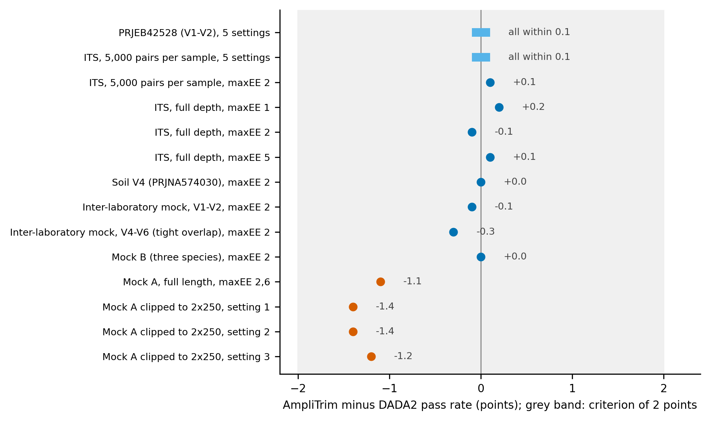
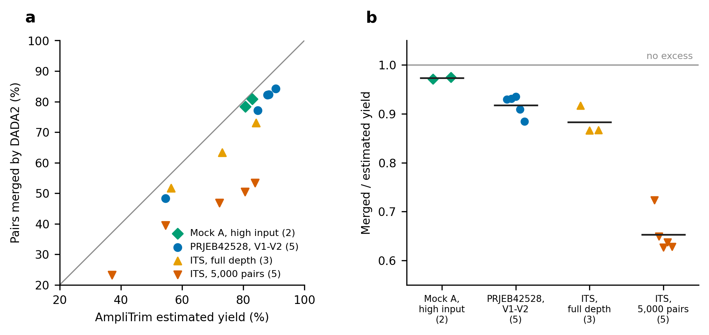
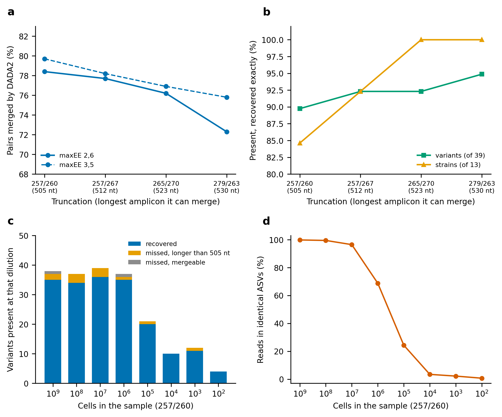
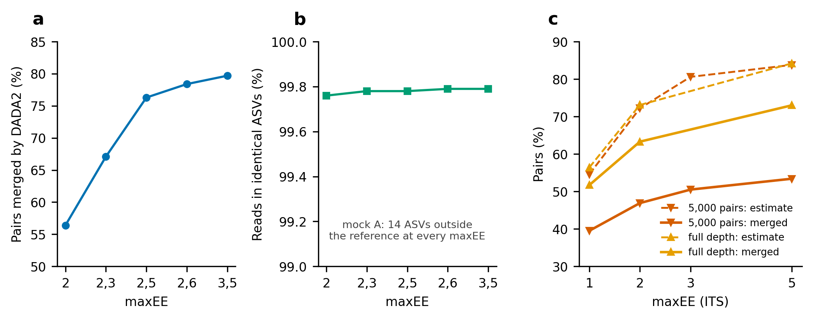
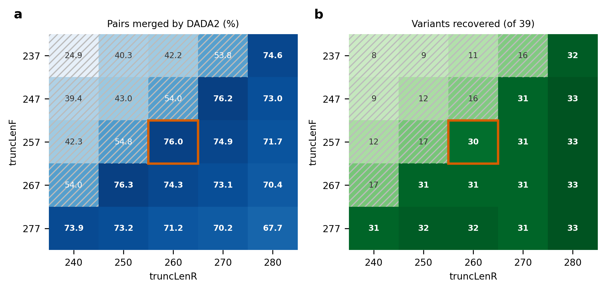

# AmpliTrim: supplement, development rounds 1 to 4

This supplement holds the results of the first four rounds of development and validation: mock community A, the coverage rule and its default, ITS mode, the effect of maxEE, and simulations with known truth. They were obtained under earlier builds and defaults (mostly `--allow-unmergeable` at 1%, before the default became 0.2%) and on partly different datasets. Where [`FINDINGS.md`](FINDINGS.md) reports the same quantity from the two fresh runs (night 1 and night 2), the fresh runs apply: its Tables 3 to 9 supersede Table 11 and the yield and FIGARO numbers below. Section and table numbers in this file refer to this file. Every test, with its command, condition and outcome, is in [`TEST_REGISTER.md`](../TEST_REGISTER.md).

## S. Results of the development rounds (formerly section 4)

### 4.0 Mock communities and real samples are reported apart

The two kinds of data answer different questions, and the numbers differ, so they are not pooled. A mock community has few taxa and known truth (accuracy can be measured; the excess of the yield estimate is small); a real sample is rich and has no truth (accuracy cannot be measured; the excess is large). Numbers for mock A and V1-V2 were refreshed on 8 October at the 0.2% default; the others are from 7 October (1% default); the full head-to-head re-test will replace all of them with one run.

**Table 11. What each kind of data shows.**

| claim | mock communities | real samples |
| --- | --- | --- |
| Filter pass rate: AmpliTrim minus DADA2 (points) | mock A -1.1; mock B 0.0; inter-laboratory V1-V2 -0.1 and V4-V6 -0.3 | V1-V2 0.0; soil V4 0.0; ITS +0.1 |
| Yield estimate minus DADA2's merged share (points) | mock A +3.9; mock B +0.4; inter-laboratory V1-V2 +0.2 and V4-V6 -1.1; simulated communities of 25 to 1,000 taxa -1.4 to +4.4 | V1-V2 +6.3; soil V4 +30.4; ITS +22.9 (5,000 pairs per sample) and +8.5 (full depth) |
| Rank correlation of the estimate over settings | 1.00 (and 1.00 in 25 of 25 simulated communities) | 1.00 |
| Rank correlation over samples | 0.60 (mock A, 23 samples) | 0.63 (V1-V2), 0.70 (V4); target 0.80, not met |
| AmpliTrim minus no truncation, merged pairs (points) | mock A +10.5; mock B +18.0; inter-laboratory V1-V2 +69.9 | V1-V2 +55.0; soil V4 +13.0; ITS +16.1 against 200/200 |
| AmpliTrim minus FIGARO at FIGARO's maxEE, merged pairs (points; 95% interval) | mock A -0.0 (-0.3 to +0.3); mock B +2.6 (+0.3 to +5.2); inter-laboratory V1-V2 -0.0 (six samples); V4-V6 not paired (5 samples) | V1-V2 +0.4 (-0.1 to +0.8); soil V4 +2.0 (+1.6 to +2.4); FIGARO cannot be run on ITS |
| Variants and strains recovered (accuracy) | FIGARO one variant more on each of mock A (31 against 30) and mock B (7 against 6), the same number of strains | not measurable: no truth |
| Coverage rule against truth | exact on mock A (no variant beyond the limit in ten settings); on real tight-overlap reads (inter-laboratory V4-V6) the recommendation sat on the floor | not measurable |

### 4.1 The filter step is predicted to within 0.2 points

On the test datasets the predicted pass rate was within 0.1 points of DADA2's at all five settings in PRJEB42528 and at all five settings in the ITS study at 5,000 pairs per sample (74.3% against 74.2% at maxEE 2), and within 0.2 points at the three settings tested at full depth in the ITS study (57.9, 75.4 and 95.8% against 57.7, 75.5 and 95.7%; Figure 2). Criterion 1 (within 2 points) was met with a margin of ten. On soil V4 (PRJNA574030, 36 samples) the difference at the default maxEE was +0.0 points, and on the six-sample inter-laboratory mock (V1-V2), on its V4-V6 reads (five samples, tight overlap) and on mock community B -0.1, -0.3 and +0.0 points.

The agreement was not as close on mock community A. At full length (255/262, maxEE 2,6, 5,000 pairs per sample) the predicted pass rate was 1.1 points lower than DADA2's, and on mock reads clipped to 2x250 (section 4.6) it was 1.2 to 1.4 points lower at all three settings tested (82.4, 82.1 and 84.6% against 83.8, 83.5 and 85.8%). Both are within the pre-set 2 points but larger than the 0.2 seen elsewhere. Because the full-length reads show it too, clipping is not the cause, and we did not establish what is.

**Figure 2. AmpliTrim's filter pass rates against DADA2's filterAndTrim on the test datasets.** Predicted minus observed pass rate; the grey band is the pre-set criterion of 2 points. For PRJEB42528 and for the ITS study at 5,000 pairs per sample, all five settings were within 0.1 points (the individual values were not kept). Soil V4, the inter-laboratory mock (V1-V2 and V4-V6), mock community B and mock community A are at the default maxEE of the standard battery (5,000 pairs per sample). The clipped mock reads are described in section 4.6.

### 4.2 The yield estimate ranks settings correctly but is an upper bound

Across five settings in PRJEB42528 (V1-V2), the yield estimate and the share DADA2 merged ranked the settings identically (rank correlation 1.00). The estimate was higher than the merged share by 6.4 points on average (range 5.7 to 7.7), and the ratio of merged to estimated yield was 0.92 (0.88 to 0.94). In the mock community (six high-input samples, 257/260, maxEE 2,6) the estimate was 80.7% against 78.4% merged, and a change that AmpliTrim predicted would add 2.2 points (maxEE 3,5 at 268/249) added 2.4 (80.8% merged).

The ITS study shows that the shortfall depends on read depth (Table 2, Figure 3). At 5,000 pairs per sample the estimate exceeded the merged share by 22.9 points on average (range 13.8 to 30.4; ratio 0.65, range 0.63 to 0.72). At full depth, on 8 samples, the excess was 8.5 points (4.7 to 11.2; ratio 0.87 to 0.92). With more reads of each sequence DADA2 denoises better, so fewer pairs are lost between filtering and merging: merged over filtered was 0.84 at full depth and 0.63 on the thinned reads, against 0.81 in the original authors' full-depth pipeline \[8\].

Criterion 3, a constant optimism across settings, was not met. Within each depth the shortfall grew with the pass rate (+4.7, +9.8 and +11.2 points at maxEE 1, 2 and 5 at full depth). The ratio was steadier than the offset at both depths, but that is a post hoc observation over three to five settings. We therefore describe the yield estimate as a ranking that is usually an upper bound, not as a prediction of the share DADA2 will merge.

Run with the final build on the other test datasets (5,000 pairs per sample; AmpliTrim's own truncation at each of three or four maxEE settings; Table 2), the estimate again ranked the settings in DADA2's order, with a rank correlation of 1.00 in every dataset, but its excess over the merged share differed widely: +0.2 points for the six-sample inter-laboratory mock (ratio 1.00; DADA2 reported about 28 ASVs), +0.3 for its V4-V6 reads (0.99; about 26 ASVs), +0.4 for mock community B (0.98; about 80 ASVs, most of them contaminants), +2.4 for mock community A (0.95; 50 ASVs), +6.3 for V1-V2 (0.93; roughly 700 to 800 ASVs) and +30.4 for soil V4 (0.69; roughly 2,000 ASVs), with ITS at +15.1 to +30.4 (0.64 to 0.72). The excess was smallest for the least diverse communities and largest for the most diverse. One reading is that the loss occurs in denoising, where sequences seen once or twice cannot be inferred, and not in filtering or merging, which the estimate models: where there is little to lose, as in the inter-laboratory mock, the estimate was almost exact. This is a post hoc reading of seven datasets and not a tested model; repeating V4 and ITS at full depth would test it. Within V1-V2 and V4 the excess was nearly constant across the maxEE settings (+6.2 to +6.4 and +29.5 to +30.9), unlike ITS and mock A, so criterion 3 held for some datasets and not for others.

The estimate was not an upper bound everywhere, and it described the pool better than the individual sample. On the mock reads clipped to 2x250 (tight overlap) DADA2 merged 0.7 points more than estimated on average (from 1.9 points more to equal; ratio 1.02, range 1.00 to 1.05), alongside the 1.3-point underestimate of the pass rate (Table 2). On real tight-overlap reads (the V4-V6 reads of the inter-laboratory mock, five samples) DADA2 merged 1.0 point more than estimated at 100,000 pairs per sample (42.9% against 41.9%) and 0.3 points fewer at 5,000 pairs; across the maxEE settings the offset ranged from -3.8 to +0.4 points, and on mock community B, where the loosest setting (maxEE 6,9) was included, from -6.5 to +1.1. The estimate is therefore not an upper bound when the overlap is tight or the filter loose. Across the 23 samples of the mock series at 257/260 and maxEE 2,6, the rank correlation between the estimated and the observed merged share was 0.60, below the pre-set 0.80, with offsets from 0.0 to +10.3 points (mean +2.6). In PRJEB42528 (33 samples, 196/159, maxEE 2) it was 0.63, with offsets from +1.4 to +14.2 points (mean +6.5). In soil V4 (36 samples) it was 0.70. We did not test why.

**Figure 3. The yield estimate against the share of pairs DADA2 merged.** (a) Each point is one setting; the line is equality. (b) The ratio of merged to estimated yield for each dataset (bar: mean); the number of settings compared is in brackets. Values are transcribed from the comparison outputs and were not regenerated from the saved tables.

**Table 2. Agreement between AmpliTrim's estimates and DADA2, by marker and region.** Offset = estimated yield minus the share of pairs DADA2 merged (percentage points); ratio = merged divided by estimated yield.

| Marker, region (dataset; settings compared) | Largest filter difference (points) | Rank correlation | Offset, mean (range) | Ratio, mean (range) |
| --- | --- | --- | --- | --- |
| 16S V1-V2 (PRJEB42528; 5 truncations) | 0.1 | 1.00 | +6.4 (5.7 to 7.7) | 0.92 (0.88 to 0.94) |
| 16S V1-V2 (PRJEB42528; 3 maxEE settings) | 0.0 (default maxEE) | 1.00 | +6.3 (+6.2 to +6.4) | 0.93 |
| 16S V1-V2 (PRJEB42528, per sample; 33 samples) | - | 0.63 | +6.5 (+1.4 to +14.2) | - |
| 16S V1-V3 (mock A, high input; 4 maxEE settings) | 1.1 (estimate lower) | 1.00 | +2.4 (+0.3 to +3.9) | 0.95 |
| 16S V1-V3 (mock A clipped to 2x250; 3) | 1.4 (estimate lower) | - | -0.7 (-1.9 to 0.0) | 1.02 (1.00 to 1.05) |
| 16S V1-V3 (mock A, per sample; 23 samples) | - | 0.60 | +2.6 (0.0 to +10.3) | - |
| 16S V4 (PRJNA574030; 3 maxEE settings, 5,000 pairs per sample) | 0.0 (default maxEE) | 1.00 | +30.4 (+29.5 to +30.9) | 0.69 |
| 16S V4 (PRJNA574030, per sample; 36 samples) | - | 0.70 | - | - |
| 16S V1-V2 (inter-laboratory mock; 3 maxEE settings; 6 samples) | 0.1 | 1.00 | +0.2 (-0.1 to +0.4) | 1.00 |
| 16S V4-V6 (inter-laboratory mock, tight overlap; 4 maxEE settings; 5 samples) | 0.3 (estimate lower) | 1.00 | -1.1 (-3.8 to +0.4) | 0.99 |
| 16S V1-V3 (mock B, three species; 4 maxEE settings; 8 samples) | 0.0 (default maxEE) | 1.00 | -1.1 (-6.5 to +1.1) | 0.98 |
| ITS (PRJEB58189, 5,000 pairs per sample; 5) | 0.1 | 1.00 | +22.9 (13.8 to 30.4) | 0.65 (0.63 to 0.72) |
| ITS (PRJEB58189, full depth, 8 samples; 3) | 0.2 | 1.00 | +8.5 (4.7 to 11.2) | 0.88 (0.87 to 0.92) |

### 4.3 Against FIGARO and fixed settings

In PRJEB42528 (V1-V2, 33 samples), AmpliTrim's default setting (maxEE 2) gave 84.2% merged pairs against 82.2% for FIGARO's choice (225/130 with maxEE 2,1). The gap came from maxEE, not from truncation. When AmpliTrim searched at FIGARO's own maxEE (2,1), it chose 211/144, and DADA2 merged 82.3% against FIGARO's 82.2%. Two different truncations gave the same result, which suggests a flat optimum near the best settings. Adding overlap lost pairs: 230/200 gave 77.1% and 260/260 gave 48.3%. FIGARO could use only 47% of the pairs because the reads were of mixed lengths. In the comparisons below the two tools chose essentially the same total length (the longest amplicon plus the overlap, for example 355 nt on V1-V2 and 527 nt on mock community B) and differed in how it is split between the forward and the reverse read and, by default, in maxEE.

The final-build run repeated the comparison on five datasets, with the difference taken per sample (Table 3). At FIGARO's own maxEE AmpliTrim merged as many pairs or more. The difference was within the pre-set 1 point on V1-V2 (+0.1, interval -0.4 to +0.6), on mock community A (-0.2; six samples) and on the six-sample inter-laboratory mock (0.0), and AmpliTrim was better on soil V4 (+2.0, +1.6 to +2.4) and on mock community B (+2.6, +0.3 to +5.2; eight samples), where the equivalence margin was exceeded in AmpliTrim's favour. End to end, AmpliTrim's default merged more than FIGARO as shipped on V1-V2 (+2.0), V4 (+4.3) and the inter-laboratory mock (+2.3), and less on mock community A (-1.9, -3.9 to -0.6) and on mock community B (-54.1, -58.0 to -50.3). In both mocks FIGARO had chosen a looser maxEE than AmpliTrim's default of 2: 3,4 on mock A and 6,9 on mock B. On mock B the reverse reads are poor, and AmpliTrim's default passed 20% of the pairs (19.9% merged) against 74.3% merged at FIGARO's maxEE; the truncation was the same (279/248), so the whole difference was maxEE. AmpliTrim's own table had shown 49% at maxEE 2,5 and 56% at 5,5 and its report had warned that only 20% of the pairs would pass, but AmpliTrim does not change maxEE by itself. We therefore claim equivalence with FIGARO at equal maxEE on three of five datasets and a higher share of merged pairs on two, and that the default maxEE, and not the truncation, accounts for every case in which FIGARO did better. That is a limit of the default and not of the truncation search: a user whose reads pass poorly at maxEE 2 should read the maxEE table. FIGARO cannot be run on ITS reads, and the V4-V6 reads (five samples) were too few for a paired comparison. On the two mocks with expected sequences the advantage in merged pairs did not carry over to accuracy: at the same maxEE FIGARO recovered one variant more (31 against 30 on mock A, 7 against 6 on mock B), the same number of strains, and on mock B 3.0 points more reads in identical ASVs (78.3% against 75.3%). Superiority here therefore means merged pairs only.

**Could a maxEE rule do better than FIGARO's?** Before building an automatic maxEE we asked whether one could match FIGARO's retention without keeping noisier reads, using AmpliTrim's exact quality table on the six datasets with a FIGARO row (no DADA2 was run). At AmpliTrim's truncation, the maxEE that reaches FIGARO's retention gave kept reads with about the same expected errors on three datasets (mock B, the inter-laboratory V1-V2 and soil V4) and a mixed result on three (V1-V2, mock A and the inter-laboratory V4-V6: one read cleaner and the other noisier, by 0.03 to 0.5 expected errors); on none were they consistently cleaner. FIGARO chose a stricter maxEE than DADA2's default on high-quality reads (1,1 on V4 and on the inter-laboratory V1-V2; 2,1 on V1-V2) and a looser one on poor reads (3,4; 4,4; 6,9), so what it adds is adapting in both directions, which AmpliTrim's fixed default of 2 does not. The best of the candidate rules (the strictest maxEE reaching a retention target of 80%) met the condition fixed in advance on 3 of the 6 datasets, and 4 were required, so no automatic rule was built. Expected errors per kept read are also a poor guide to accuracy: on mock B FIGARO's kept reverse reads carried 3.6 expected errors, and its ASVs recovered all seven expected variants. FIGARO's own derivation of maxEE from the reads at each cut was not among the candidate rules; it is available to AmpliTrim users by running FIGARO and passing its maxEE to --max-ee.

**Table 3. AmpliTrim minus FIGARO in the share of pairs merged by DADA2 (points), paired per sample, with the 95% bootstrap interval.** At FIGARO's own maxEE, and with AmpliTrim's default setting against FIGARO as it ships. The two six-sample datasets are marked: a bootstrap over six samples is not reliable.

| Dataset (samples) | AmpliTrim at FIGARO's maxEE minus FIGARO | AmpliTrim default minus FIGARO as shipped |
| --- | --- | --- |
| PRJEB42528, V1-V2 (33) | +0.1 (-0.4 to +0.6) | +2.0 (+1.5 to +2.5) |
| Mock community A, V1-V3 (6, not reliable) | -0.2 (-0.8 to +0.6) | -1.9 (-3.9 to -0.6) |
| PRJNA574030, V4 (36) | +2.0 (+1.6 to +2.4) | +4.3 (+3.7 to +4.9) |
| Inter-laboratory mock, V1-V2 (6, not reliable) | 0.0 (0.0 to 0.0) | +2.3 (+2.2 to +2.5) |
| Mock community B, V1-V3 (8) | +2.6 (+0.3 to +5.2) | -54.1 (-58.0 to -50.3) |

### 4.4 The coverage rule, tested against ground truth

The coverage rule (an amplicon of length L needs a total of at least L + 12) was checked against DADA2 on simulated communities during development (supplement, S3). Here it is tested on mock community A, where the expected sequences, and so their lengths, are known.

**Mock community A, six high-input samples.** We ran DADA2 on the six samples at five truncations and two maxEE settings and scored each run against the 39 variants (13 strains) present in those samples (Table 4, Figure 4a and 4b). The coverage rule held in every run: no variant longer than the merge limit (the total minus 12 nt) was recovered in any of the ten. E. faecalis (508 nt) was recovered at every total of 524 nt or more (257/267, 265/270, 279/263) and not below, and L. reuteri (523 nt) at every total of 535 nt or more (265/270, 279/263), as the rule predicts. Each step in the limit recovered more and cost merged pairs: at maxEE 2,6, from 257/260 (limit 505 nt) to 257/267 (512), 265/270 (523) and 279/263 (530), the merged share fell from 78.4% to 77.7%, 76.2% and 72.3%, while the strains recovered rose from 11 to 12, 13 and 13. The authors' own setting was truncLen 299/280 after trimming 20 and 17 nt of primer, which is 279/263 in the coordinates used here.

The pre-set criterion that AmpliTrim's truncation is not inferior to the authors' was not met. At maxEE 2,6, 257/260 recovered 35 of 39 variants and 11 of 13 strains against 37 and 13 for the authors' 279/263, which is 2 variants and 2 strains fewer; it had 8 more ASVs outside the reference (15 against 7); and its share of reads in identical ASVs was 0.08 points lower (99.73% against 99.81%, within the 0.10 margin). The alternative 268/249 gave the same shortfall in variants and strains (13 more ASVs outside the reference), and so did both truncations at maxEE 3,5. In exchange, 257/260 merged 6.1 points more pairs (78.4% against 72.3%; 79.7% against 75.8% at maxEE 3,5). Applying the same margins afterwards to 265/270, which the automatic verdicts did not include, the difference was 1 variant fewer, no strain fewer, 0.07 points fewer reads in identical ASVs and 5 more ASVs outside the reference; the count of ASVs outside the reference was the only margin exceeded. What those ASVs are is classified below (Table 5).

**Table 4. Mock community A, six high-input samples: truncation and maxEE.** Variants and strains are those present in these samples (39 and 13), recovered exactly. The longest amplicon merged is the total minus 12 nt.

| Truncation | Longest amplicon merged (nt) | maxEE | Pairs passing | Pairs merged | Variants (of 39) | Strains (of 13) | Reads in identical ASVs | ASVs outside the reference |
| --- | --- | --- | --- | --- | --- | --- | --- | --- |
| AmpliTrim, 257/260 | 505 | 2,6 | 81.6% | 78.4% | 35 | 11 | 99.73% | 15 |
| AmpliTrim, 257/260 | 505 | 3,5 | 82.9% | 79.7% | 35 | 11 | 99.73% | 15 |
| AmpliTrim alternative, 268/249 | 505 | 2,6 | 80.4% | 77.6% | 35 | 11 | 99.72% | 20 |
| AmpliTrim alternative, 268/249 | 505 | 3,5 | 83.7% | 80.8% | 35 | 11 | 99.79% | 19 |
| Longer, 257/267 | 512 | 2,6 | 80.6% | 77.7% | 36 | 12 | 99.70% | 13 |
| Longer, 257/267 | 512 | 3,5 | 81.1% | 78.2% | 35 | 12 | 99.75% | 12 |
| Longer, 265/270 | 523 | 2,6 | 79.0% | 76.2% | 36 | 13 | 99.74% | 12 |
| Longer, 265/270 | 523 | 3,5 | 79.7% | 76.9% | 36 | 13 | 99.74% | 12 |
| Authors', 279/263 | 530 | 2,6 | 75.0% | 72.3% | 37 | 13 | 99.81% | 7 |
| Authors', 279/263 | 530 | 3,5 | 78.5% | 75.8% | 37 | 13 | 99.81% | 7 |

**What the ASVs outside the reference are.** We classified every ASV that was not an expected sequence (Table 5). At every truncation, 5 of them were contaminants, carrying 0.13 to 0.15% of the reads; all five were also present at the authors' truncation, where they were 5 of its 7. The excess of AmpliTrim's 257/260 over the authors' 279/263 (7 more ASVs outside the expected sequences, and one more listed variant that is not present in these samples) was mainly chimeras: 5 against 1, carrying 0.01% of the reads, with one more each of error variants, unlisted variants and unexplained ASVs. The truncation with the most retention, 268/249, had the most chimeras (9). These are chimeras that DADA2's own removal had not caught, at very low abundance. The classes are evidence and not proof, and an ASV called an error variant could be a real variant.

**Table 5. The ASVs outside the expected sequences, by class (six high-input samples, maxEE 2,6).** Number of ASVs, with their share of all ASV reads in brackets. At maxEE 3,5 the classes were the same apart from one listed variant at two truncations.

| Truncation | ASVs outside the expected sequences | Contaminant | Chimera | Error variant | Unlisted variant | Unexplained | Listed variant not present here |
| --- | --- | --- | --- | --- | --- | --- | --- |
| 257/260 (AmpliTrim) | 14 | 5 (0.14%) | 5 (0.01%) | 1 (0.01%) | 1 (0.02%) | 2 (0.03%) | 1 (0.06%) |
| 257/267 | 12 | 5 (0.14%) | 3 (0.02%) | 1 (0.03%) | 1 (0.02%) | 2 (0.03%) | 1 (0.05%) |
| 265/270 | 12 | 5 (0.14%) | 2 (0.02%) | 2 (0.04%) | 1 (0.02%) | 2 (0.03%) | 0 (0.00%) |
| 268/249 | 19 | 5 (0.14%) | 9 (0.03%) | 0 (0.00%) | 0 (0.00%) | 5 (0.05%) | 1 (0.06%) |
| 279/263 (authors') | 7 | 5 (0.15%) | 1 (0.00%) | 0 (0.00%) | 0 (0.00%) | 1 (0.03%) | 0 (0.00%) |

**Coverage levels.** AmpliTrim's own search at each coverage level, the share of the longest amplicons it may leave out, gave three distinct truncations on these samples (Table 6). At 1% and 0.5% it stayed at 257/260, because only 0.31% of the amplicons are longer than its 505 nt limit. At 0.2% and 0.1% it chose 257/263 (limit 508 nt, 0.06% of amplicons left out): merged pairs fell by 0.2 points (78.4% to 78.2%), one more variant (36 of 39) and one more strain (12 of 13) were recovered, and the ASVs outside the reference fell from 15 to 11. Covering every amplicon (0%, 268/280, limit 536 nt) cost 5.2 points of merged pairs (73.2%) for one more strain (13 of 13) and no further variant. AmpliTrim's estimate was 80.7% for the first four levels, so it did not resolve the 0.2-point difference. In the ASVs found by the most inclusive truncation, 3 ASVs (0.25% of the reads) lay beyond the 1% limit and 2 (0.02%) beyond the 0.2% limit. A repeat of these mock A runs on another day gave identical numbers. On V1-V2 (PRJEB42528; no expected sequences, so the cost only) AmpliTrim chose 196/159 at 1% and 195/168 at 0.2%, which DADA2 merged at 83.9% and 83.5% of pairs (5,000 pairs per sample), a cost of 0.4 points, whereas covering every amplicon (279/280) cost 54 points (29.4% merged). On soil V4, AmpliTrim chose 120/118 at 1% and 124/115 at 0.2%, and DADA2 merged 2.6 points more at the second (66.8% against 64.3%); on the inter-laboratory mock both levels chose 160/165. On the V4-V6 reads (five samples) and on mock community B the two levels chose the same truncation (273/265 and 280/247), so the 0.2% level cost nothing there, and on mock B it changed no variant or strain (3 of 3 strains and the same variants at both levels). Mock B has no amplicon beyond the 1% limit, because its amplicons are 459 to 515 nt, so it could show no benefit and tested only whether the change does harm. The cost of the 0.2% level was therefore 0.0 points in median and at most 0.4 points on any of six datasets, and on the two datasets with expected sequences it recovered one more strain on one and changed nothing on the other. The rule fixed in advance (a benefit on at least one dataset with expected sequences and none worse; a median cost of at most 2 points and at most 5 on any) was met, and the default of --allow-unmergeable is now 0.2%. The benefit rests on one strain of one mock community; --allow-unmergeable 0.01 restores the old default.

**Table 6. Coverage levels on mock community A (six high-input samples, maxEE 2,6).** The census of ASVs beyond each limit uses the 268/280 run.

| Coverage level | Truncation | Longest amplicon merged (nt) | Amplicons left out | AmpliTrim estimate | Pairs merged | Variants (of 39) | Strains (of 13) | ASVs outside the reference | ASVs beyond the limit |
| --- | --- | --- | --- | --- | --- | --- | --- | --- | --- |
| 1% | 257/260 | 505 | 0.31% | 80.7% | 78.4% | 35 | 11 | 15 | 3 (0.25% of reads) |
| 0.5% | 257/260 | 505 | 0.31% | 80.7% | 78.4% | 35 | 11 | 15 | 3 (0.25% of reads) |
| 0.2% | 257/263 | 508 | 0.06% | 80.7% | 78.2% | 36 | 12 | 11 | 2 (0.02% of reads) |
| 0.1% | 257/263 | 508 | 0.06% | 80.7% | 78.2% | 36 | 12 | 11 | 2 (0.02% of reads) |
| 0% | 268/280 | 536 | 0.00% | 76.3% | 73.2% | 36 | 13 | 11 | 0 (0.00% of reads) |

**Mock community B, an independent reference.** Mock community B is the three-species Zymo spike-in D6321 (Truepera radiovictrix, Imtechella halotolerans and Allobacillus halotolerans), from the same laboratory. Its expected sequences are Zymo's own reference 16S genes, which do not come from a DADA2 run, cut between the primers: seven variants (four of A. halotolerans, one of I. halotolerans, two of T. radiovictrix; a consensus sequence in the Zymo file was left out because it is not an observed copy). The amplicon lengths in the reads before any filtering (median 459 nt, 99th percentile 515 nt) matched the reference (459, 480 and 515 nt). The eight mock samples (four replicates at each of two dilutions) carry about a third of their reads as contaminants of the extraction buffer, so the share of reads in identical ASVs is bounded (54 to 78%) and 17 to 69 ASVs lay outside the reference. At 5,000 pairs per sample, every method recovered three of three strains, including the untruncated reads. Variants recovered were 6 of 7 at AmpliTrim's truncation (279/248, 280/247 and 277/250 at maxEE 2, 1 and 5), 7 of 7 with FIGARO (279/248 at maxEE 6,9, the same truncation as AmpliTrim's default) and 4 of 7 without truncation, which merged 2.0% of the pairs against 19.9%. A looser maxEE bought retention here too: 5.7%, 19.9% and 55.8% of pairs merged at maxEE 1, 2 and 5, with 68.3%, 68.7% and 73.6% of the reads in identical ASVs. The prediction held: the estimate was within 0.4 points of the merged share at the default maxEE (ratio 0.98) and ranked the four maxEE settings as DADA2 did. Mock B tested the filter, the yield and the comparison with FIGARO against an independent reference; it could not test the coverage rule, because none of its amplicons is longer than 515 nt.

**Dilution series.** We then ran DADA2 on each of the eight dilutions separately at the same three truncations and scored it against the variants present at that dilution in the authors' own table (Table 7, Figure 4c). At 257/260, recovery of the present variants was 93% (185 of 198 variant-dilution pairs) and did not fall with input: 35 of 38 at 10^9 cells, 34 of 37 at 10^8, and 4 of 4 at 10^2. Of the 13 misses, 11 were variants longer than 505 nt: E. faecalis (508 nt), missed at all six dilutions where it was present, and L. reuteri (523 nt), missed in five variant-dilution pairs. The other two (S. epidermidis, 497 nt, at 10^9; E. coli, 490 nt, at 10^6) were mergeable. Tracing the reads before any filtering showed that both variants are present (9 and 242 identical reads) but lie 1 or 2 edits from a much more abundant ASV (107 and 1,085 reads), which DADA2 absorbed them into: a limit of denoising that no truncation changes. The E. faecalis variant was present as 42 identical reads at 10^9 cells with no ASV within 51 edits, and the L. reuteri variant as 2 reads: lost at merging, and below detection. At 265/270 there were 3 misses (193 of 198, 97%) and at 279/263 there were 4 (194 of 198, 98%); none of them was longer than the limit. The cost was in merged pairs: 78.5%, 76.5% and 73.0% at the three truncations at 10^9 cells, and 78.9%, 76.3% and 63.9% at 10^4. In the six high-input samples the E. faecalis variant carried 215 reads, 0.22% of the reads in expected sequences, so the default rule of leaving out up to 1% of the longest amplicons cost two real strains. AmpliTrim's report had flagged this beforehand: 0.31% of the pairs were longer than 505 nt.

What fell with input was the share of reads in expected sequences, from 99.84% at 10^9 cells to 0.67% at 10^2, because contaminants replace the mock (ASVs outside the reference rose from 9 to 143 at 257/260). We had predicted that variant recovery would also fall at low input, and it did not. This result is partly circular: the variants counted as present at low input are those the authors' own pipeline detected, so the series measures agreement with that pipeline and does not give an absolute detection limit. At 257/260 the pass rate (79.3 to 82.9%) and merged share (78.0 to 81.9%) were stable across dilutions, whereas at the authors' truncation the merged share fell with input (76.3% at 10^7 and 63.9% at 10^4).

**Figure 4. Mock community A: the cost of the coverage limit, and the dilution series.** (a, b) Six high-input samples at maxEE 2,6 (solid) and 3,5 (dashed). Raising the longest amplicon a truncation can merge from 505 to 530 nt costs merged pairs (a) and recovers more of the variants and strains present (b). (c) Variants present at each dilution, by whether they were recovered exactly at 257/260; most misses are variants longer than the 505 nt limit. At 265/270 there were 3 misses and at 279/263 there were 4, none of them longer than the limit. (d) Share of reads in ASVs identical to an expected sequence at 257/260, which falls as contaminants replace the mock.

**Table 7. Mock community A, dilution series at three truncations (maxEE 2,6; each dilution run separately).** Variants are recovered exactly, out of those present at that dilution in the authors' table. Pairs merged is the share of input pairs merged by DADA2.

| Cells | Variants present | Recovered at 257/260 | Recovered at 265/270 | Recovered at 279/263 | Merged at 257/260 | Merged at 265/270 | Merged at 279/263 |
| --- | --- | --- | --- | --- | --- | --- | --- |
| 10^9 | 38 | 35 | 36 | 36 | 78.5% | 76.5% | 73.0% |
| 10^8 | 37 | 34 | 36 | 37 | 78.0% | 75.8% | 71.0% |
| 10^7 | 39 | 36 | 38 | 39 | 81.9% | 79.7% | 76.3% |
| 10^6 | 37 | 35 | 36 | 36 | 81.4% | 79.0% | 73.6% |
| 10^5 | 21 | 20 | 21 | 21 | 78.9% | 77.0% | 67.5% |
| 10^4 | 10 | 10 | 10 | 10 | 78.9% | 76.3% | 63.9% |
| 10^3 | 12 | 11 | 12 | 12 | 81.2% | 79.2% | 70.1% |
| 10^2 | 4 | 4 | 4 | 3 | 79.6% | 79.2% | 68.6% |
| All dilutions | 198 | 185 | 193 | 194 | - | - | - |

### 4.5 maxEE: what a looser limit buys and what it costs

**Mock community A.** With the truncation held at 257/260, raising maxEE from 2 to 3,5 raised the share of pairs merged from 56.4% to 79.7% (+23.3 points). The share of reads in ASVs identical to expected sequences stayed at 99.76 to 99.79%, the number of ASVs outside the reference stayed at 14, and the ASV count moved from 49 to 50 (Table 8, Figure 5a and 5b). Variants recovered (35 or 36 of the 53 in the full reference, of which 39 are present in these samples), strains recovered (11 of 14) and the chimera share of merged pairs (5.5%) did not change. On this community a looser maxEE had no measurable accuracy cost, and the truncation grid (Table 4) agrees: maxEE 3,5 against 2,6 changed neither the variants nor the strains recovered at four of five truncations (one variant fewer at 257/267). Truncation also mattered: under the same filter (maxEE 2,6), the authors' 279/263 gave 72.3% merged against 78.4% at 257/260, 6.1 points fewer. The standard battery of the final build, run on the same six samples at 5,000 pairs per sample, agreed in direction: AmpliTrim's own truncation at maxEE 1, 2,6 and 5 merged 42.6%, 74.6% and 84.2% of pairs and recovered 28, 29 and 32 variants (10, 10 and 11 of 13 strains), with 99.70%, 99.75% and 99.81% of reads in identical ASVs, and FIGARO's choice (273/244, maxEE 3,4) merged 76.4% and recovered 31 variants (10 strains). With no truncation, 64.2% of pairs merged and 97.70% of reads were in identical ASVs, about 2 points fewer than at AmpliTrim's truncation (99.75%), so truncation improved the accuracy of the reads as well as their number. The counts are lower than above because only 5,000 pairs per sample were used.

**ITS.** At 5,000 pairs per sample (37 samples), the per-sample difference in merged share against maxEE 2 was +3.7 points (95% interval 3.3 to 4.1) for maxEE 3, +6.5 (5.7 to 7.4) for maxEE 5 and -7.4 (-7.8 to -7.0) for maxEE 1, each in all 37 samples, and a 200/200 truncation, the kind of setting used for 16S, cost 23.5 points (-25.2 to -21.8; 23.3% merged against 46.9%). Criterion 4 was met (Table 9, Figure 5c). At full depth (8 samples), maxEE 2 beat maxEE 1 by 11.4 points (10.7 to 12.2) and maxEE 5 beat it by 20.9 (19.5 to 22.3), in 8 of 8 samples. Going from maxEE 1 to 5, the estimate gained 27.8 points and DADA2 merged 21.3 more, 77% of what the estimate promised; on the thinned reads the share was 48%. The earlier impression that a looser maxEE buys about half of what the estimate suggests was thus an effect of thinning. The number of ASVs did not rise with a looser limit (5,315, 5,456 and 5,387 at maxEE 1, 2 and 5), the share of reads in the 15 commonest ASVs fell from 27.1% to 24.3%, and ASVs above 0.1% of reads were 146, 149 and 153. These are proxies: without expected sequences for ITS they do not establish accuracy.

**Figure 5. Effect of maxEE.** (a, b) Mock community A at 257/260: the share of pairs merged rises by 23 points while the share of reads in identical ASVs is unchanged (note the y-axis range). (c) ITS: estimated yield (dashed) and pairs merged by DADA2 (solid) at 5,000 pairs per sample and at full depth.

**Table 8. maxEE on mock community A (six high-input samples, 257/260).**

| maxEE | Pairs merged | Reads in identical ASVs | ASVs outside the reference | ASVs | Variants recovered (of 53) | Strains recovered (of 14) |
| --- | --- | --- | --- | --- | --- | --- |
| 2 | 56.4% | 99.76% | 14 | 49 | 35 | 11 |
| 2,3 | 67.1% | 99.78% | 14 | 49 | 35 | 11 |
| 2,5 | 76.3% | 99.78% | 14 | 50 | 36 | 11 |
| 2,6 | 78.4% | 99.79% | 14 | 50 | 36 | 11 |
| 3,5 | 79.7% | 99.79% | 14 | 50 | 36 | 11 |

**Table 9. maxEE and truncation in ITS (PRJEB58189). Differences are per sample against the baseline row, with a bootstrap 95% interval over samples.**

| Depth | Setting | Estimated yield | Pairs merged | Difference from baseline (points) |
| --- | --- | --- | --- | --- |
| 5,000 pairs per sample, 37 samples | maxEE 1 | 54.6% | 39.5% | -7.4 (-7.8 to -7.0) |
|  | maxEE 2 (baseline) | 72.2% | 46.9% | - |
|  | maxEE 3 | 80.6% | 50.5% | +3.7 (+3.3 to +4.1) |
|  | maxEE 5 | 83.8% | 53.4% | +6.5 (+5.7 to +7.4) |
|  | Truncation 200/200 | 37.1% | 23.3% | -23.5 (-25.2 to -21.8) |
| Full depth, 8 samples | maxEE 1 (baseline) | 56.4% | 51.7% | - |
|  | maxEE 2 | 73.1% | 63.3% | +11.4 (+10.7 to +12.2) |
|  | maxEE 5 | 84.2% | 73.0% | +20.9 (+19.5 to +22.3) |

### 4.6 Landscape, tight overlap, pooling, stability, chimeras, and the pre-set criteria

**Landscape around the recommendation.** To test whether the recommendation is near the best available choice, we ran DADA2 on a 5 x 5 grid of truncations in steps of 10 nt around AmpliTrim's 257/260 (maxEE 2,6; the six high-input mock samples thinned to 10,000 pairs each; Figure 6). The share of pairs merged collapsed below AmpliTrim's coverage floor, a total of 517 nt: 54 to 55% at 507 nt, 42 to 43% at 497 nt, 39 to 40% at 487 nt and 25% at 477 nt, against 74 to 76% at the floor. Above the floor it declined slowly, by about 1 to 3 points per 10 nt. The best setting of the grid, 267/250 (76.3%), had the same total as AmpliTrim's 257/260 (76.0%), so the recommendation was 0.3 points below the best setting that covers the amplicons, within the pre-set margin of 1 point. Variants recovered followed the same pattern: 8 to 17 of 39 below the floor and 30 to 33 at or above it (30 at AmpliTrim's cell, 31 at the best). The floor is therefore not a conservative margin; it marks where merging collapses. The same held in PRJEB42528 (V1-V2; a 3 x 3 grid in steps of 10 nt around 196/159, maxEE 2, 3,000 pairs per sample, floor 355 nt): the recommendation merged 82.6% of pairs against 82.7% for the best setting that covers the amplicons (186/169), 0.1 points below, and merging fell to 71.8 to 72.0% at 10 nt below the floor and to 60.9% at 20 nt below. On soil V4 (a 3 x 3 grid around 120/118, 3,000 pairs per sample) the recommendation merged 59.6% against 66.4% for the best setting that covers the amplicons (130/108), 6.8 points below and outside the margin: the best cells kept the same total of 238 nt but shortened the reverse read. On the six-sample inter-laboratory mock it was 0.1 points below the best of nine, and on mock community B and on the V4-V6 reads it was 0.0 points below the best feasible setting. The V4-V6 reads show the cliff on real tight-overlap data. With a floor of 538 nt (the longest amplicon, 526 nt, plus 12), no pair merged at 263/255, 263/265 or 273/255 (totals of 518, 528 and 528 nt), and 40.0% and 41.3% merged at 263/275 and 273/265 (538 nt), the best setting being AmpliTrim's. We did not test whether the V4 gap persists at full depth.

**Figure 6. The landscape around AmpliTrim's recommendation (mock community A, six high-input samples, 10,000 pairs per sample, maxEE 2,6).** DADA2 was run at every cell. Hatched cells have a total below AmpliTrim's coverage floor (517 nt); the red frame is AmpliTrim's recommendation, 257/260. (a) Share of pairs merged. (b) Variants recovered, of the 39 present.

**Tight overlap (emulated).** To approximate a tight-overlap case with known truth, the reads of the six mock samples were clipped to 250 nt each. A total of 500 nt then merges only amplicons up to 488 nt, and the amplicons here are 460 to 523 nt. AmpliTrim recommended 249/249, in effect no truncation, and DADA2 merged 44.4% of the pairs: the same as 250/250 (difference -0.0 points, 95% interval -0.1 to +0.0) and 4.0 points more than a fixed 240/240 (interval 2.5 to 5.6, in 6 of 6 samples). AmpliTrim and 250/250 each recovered 15 variants, against 11 at 240/240, and only 4 of 13 strains (2 at 240/240): reads that short cannot cover this amplicon, and no truncation fixes that. FIGARO was not run on these reads. On real tight-overlap reads (the V4-V6 reads of the inter-laboratory mock, a median amplicon of 523 nt on 2x300 reads, five samples) AmpliTrim chose 273/265, a total of 538 nt, exactly the floor, with about 15 nt of overlap. DADA2 merged 41.3% of the pairs at that setting at 3,000 pairs per sample (42.9% at 100,000) and none at the three grid cells below the floor; the estimate was within 1.0 point of DADA2's share at both depths.

**Pooled inference.** Per-sample inference (used throughout), pseudo-pooled inference and fully pooled inference at 257/260 and maxEE 2,6 all recovered 35 of 39 variants and 11 of 13 strains. Pseudo-pooling gave the same ASVs (50 ASVs, 15 outside the reference). Full pooling gave 63 ASVs, 28 of them outside the reference, and lowered the share of reads in identical ASVs from 99.73% to 98.62%. The four missed variants were not rescued by pooling, which agrees with their being limited by length and not by detection.

**Stability.** The recommendation at maxEE 2 did not depend on the subsample. Over three subsample sizes (20,000 to 100,000 pairs) and two sampling strides, the six high-input samples gave 277/240 in every run (estimated yield varying by 0.5 points) and the 23 mock samples gave 274/243 to 275/242 (0.2 points), within the pre-set margins of 10 nt and 1 point. The V1-V2 reads varied by 1 nt (196/159 to 197/158), the V4 reads by 3 nt (120/118 to 123/115) the inter-laboratory mock by 3 nt (157/168 to 160/165), mock community B by 0 nt and the V4-V6 reads by 1 nt (273/265 to 274/264), also within the margins.

**ITS chimeras.** The chimera settings did not explain the difference from the original authors' pipeline, which removed 13.9% of merged reads. On the eight full-depth ITS samples, DADA2's defaults removed 0.2%, a q2-dada2-like setting (consensus, minimum parent fold 1.0) removed 0.6%, and pooled detection removed 1.5%, with 63.3% of pairs merged in all three.

**Table 10. Outcomes against the pre-set criteria.**

| Criterion | Outcome | Evidence |
| --- | --- | --- |
| 1. Filter pass rate predicted within 2 points | Met | Within 0.2 points in 13 real-study comparisons, on V4 (+0.0), on the inter-laboratory mock (-0.1; -0.3 on its V4-V6 reads) and on mock B (+0.0); 1.1 points low on mock A at full length and 1.2 to 1.4 on clipped reads |
| 2. Yield estimate ranks settings as DADA2 does | Met | Rank correlation 1.00 in every dataset (V1-V2, mock A, V4, inter-laboratory mock (two regions), mock B, ITS; 3 to 5 settings) |
| 3. Yield optimism constant across settings | Not met | +4.7 to +11.2 points at full depth in ITS and +15.1 to +30.4 at 5,000 pairs; +0.3 to +3.9 on mock A; but only +6.2 to +6.4 on V1-V2 and +29.5 to +30.9 on V4 |
| 4. ITS: a 16S-style truncation costs at least 10 points | Met | -23.5 points (95% interval -25.2 to -21.8) |
| 5. AmpliTrim's truncation not inferior to the authors' (mock A; margins 1 variant, 1 strain, 0.10 points, 2 ASVs) | Not met | 257/260: 2 variants and 2 strains fewer, 0.08 points fewer reads in identical ASVs, 8 more ASVs outside the reference (mainly chimeras at 0.01% of reads); the same for 268/249 at both maxEE. Applied afterwards to the 0.2% level (257/263): 1 variant and 1 strain fewer (within the margins), 4 more ASVs outside the reference (not within) |
| 6. No variant longer than total minus 12 nt is recovered | Met | 0 of 10 settings; misses longer than the limit 11 of 13, then 0 of 3, then 0 of 4 as the total grows |
| 7. Recommendation stable across subsample sizes (10 nt, 1 point) | Met | 0 to 3 nt on seven datasets; 0.2 to 0.5 points on the mock series |
| 8. Per-sample rank correlation of the estimate at least 0.80 | Not met | 0.60 over 23 mock samples; 0.63 over 33 V1-V2 samples; 0.70 over 36 V4 samples |
| 9. Pooled inference does not lose variants | Met | Same variants and strains; full pooling adds 13 ASVs outside the reference |
| 10. AmpliTrim no worse than no truncation under tight overlap (clipped mock) | Met | 15 and 15 variants; -0.0 points (-0.1 to +0.0) |
| 11. AmpliTrim equals FIGARO at FIGARO's maxEE (interval within 1 point) | Met on 3 of 5 datasets (never worse in merged pairs) | At FIGARO's maxEE (V1-V2 and mock A refreshed on 8 October at the 0.2% default, the rest from 7 October): V1-V2 +0.4 (-0.1 to +0.8); mock A 0.0 (-0.3 to +0.3) and inter-laboratory mock 0.0 (six samples each); V4 +2.0 (+1.6 to +2.4) and mock B +2.6 (+0.3 to +5.2), outside the margin in AmpliTrim's favour |
| 12. ITS chimera difference explained by DADA2's settings | No | 0.2% to 1.5% removed against 13.9% |
| 13. Recommendation within 1 point of the best DADA2 setting around it that covers the amplicons | Met on 5 of 6; not met on V4 | 0.3 points below the best of 25 runs (mock A, 10,000 pairs per sample); 0.1 points below the best of 9 (V1-V2 and the inter-laboratory mock, 3,000 pairs per sample); 0.0 points below on mock B and on the V4-V6 reads; 6.8 points below on V4 |

### 4.7 Round 4: five analyses and two simulations

Round 4 (8 October 2026) put the open questions of the validation in one run, with criteria fixed in advance (`TEST_REGISTER.md`, section 9; outcomes in section 10).

**Five analyses of results already on disk.** (1) A split with the longer forward read did not beat AmpliTrim's balanced split: the best cell with AmpliTrim's total length had the longer forward read in 3 of 6 datasets (4 were needed), and the mean gain of 1.8 points is almost all soil V4 (+4.7; mock A +0.5, V1-V2 +0.1; 0.3 without V4), so the balanced tie-break stays.
(2) The two variants that only one tool recovered differ from their nearest expected variant by one base, covered by the reverse read alone, early in it, under both splits: the position of the split does not explain FIGARO's extra variant (n = 2; most likely chance in the denoising). (3) FIGARO could use 46.5% of the pairs of V1-V2 (47% was used earlier), 52% of the inter-laboratory V1-V2 pairs and 84% to 92% on the other 16S sets (quick-run samples of the first 300 pairs per sample), and 15% on ITS, where it cannot be used.
(4) On mock A at the default setting, 0.13% of the ASV reads were off every expected length (one ASV of 435 nt, in every method, including no truncation): no false-join signature. (5) The rule 'mean expected errors at the cut + 1' reproduced FIGARO's maxEE on 4 of 6 datasets (5 were needed): it matched on clean reads, and FIGARO's value was higher on poor reads (mock B 6/9 against 3.6/6.1). No automatic maxEE is built.

**Richness (Table 12).** The excess of the yield estimate over DADA2's merged share rose with the number of taxa, from -1.4 points at 25 taxa to +4.4 at 1,000 (+3.8 between 25 and 500 taxa: partly supported, between the 3 and 10 points fixed in advance), and the estimate ranked the three maxEE settings in DADA2's order in all 25 communities.
Richness explains only a small part of the +30 points on soil V4. The simulation uses related taxa and log-normal abundances, which have a shorter tail of rare sequences than a real soil community; whether a heavier tail reproduces the excess was not tested. DADA2 recovered 89% to 96% of the taxa with at least 50 reads at every richness, and 6% to 50% of those with 10 to 49 reads, which are strains 1 to 3 bases from a sibling.

**Table 12. Simulated communities (maxEE 2; five seeds; ten samples of 5,000 pairs; qualities resampled from mock A).**

| taxa | estimate | DADA2 merged | excess | reads in exact ASVs | taxa with 50+ reads recovered | taxa with 10-49 reads recovered |
| --- | --- | --- | --- | --- | --- | --- |
| 25 | 72.6% | 74.0% | -1.4 | 99.38% | 117/124 | 0/1 |
| 100 | 72.6% | 72.6% | -0.0 | 96.65% | 348/392 | 5/89 |
| 250 | 72.9% | 72.4% | +0.5 | 94.39% | 559/631 | 116/438 |
| 500 | 73.0% | 70.6% | +2.4 | 92.64% | 849/918 | 332/1,016 |
| 1,000 | 72.9% | 68.5% | +4.4 | 92.87% | 1,064/1,105 | 1,031/2,075 |

At 1,000 taxa a looser maxEE (1, 2, 5) raised the merged share from 47.5% to 68.5% to 85.9% and lowered the share of reads in exact ASVs from 93.8% to 92.9% to 92.3%: a small accuracy cost in a rich community that the mocks did not show.

**Over-merging (Table 13).** Merges at the wrong length were 0.00% at the 12 nt minimum overlap in the clean and realistic arms (a 10 nt repeat, 1% chimeras, indels of 1e-5 per base; pairs that carry an indel change length by a base whatever the merge does and are counted apart: 97% of them came out at a different length), so the 12 nt minimum stands, and raising it from 12 to 20 nt cost about 2.5 points of DADA2's merged share and gained no taxa.
In the deliberately extreme arm (a 32 nt perfect repeat across the overlap in a fifth of the taxa, 5% chimeras, indels of 1e-4), vsearch refused most pairs of the repeat taxa (merged 30% to 88% by seed), wrong-length merges were 0.08% at 12 nt and 0.00% at 20 nt, and DADA2 put 27.2% of the reads in ASVs matching no true sequence at a 12 nt overlap, 19.4% at 16 nt and 10.1% at 20 nt: in a repeat-rich region a longer overlap helps, and the yield estimate can be far too low when such a repeat dominates the community.
The criterion for this test was changed before the full run, for two reasons. Pairs that carry an indel had been counted as false joins, and the recovery condition did not say in which direction it applied (`TEST_REGISTER.md`, section 9).

**Table 13. Over-merging simulation (25 taxa; three seeds; maxEE 2; truncation set so that the longest amplicon has the overlap shown).**

| arm | overlap | vsearch merged | wrong length, no indel | DADA2 merged | taxa recovered | reads in exact ASVs | reads in no true ASV |
| --- | --- | --- | --- | --- | --- | --- | --- |
| clean | 12 | 96.0% | 0.00% | 72.9% | 16.7 | 99.82% | 0.00% |
| clean | 16 | 99.4% | 0.00% | 71.6% | 16.7 | 99.82% | 0.00% |
| clean | 20 | 99.9% | 0.00% | 70.4% | 16.7 | 99.74% | 0.00% |
| realistic | 12 | 97.4% | 0.00% | 72.5% | 18.3 | 99.99% | 0.01% |
| realistic | 16 | 99.5% | 0.00% | 71.2% | 18.3 | 99.99% | 0.01% |
| realistic | 20 | 99.9% | 0.00% | 70.0% | 18.3 | 100.00% | 0.00% |
| stress | 12 | 67.3% | 0.08% | 70.4% | 14.3 | 68.22% | 27.19% |
| stress | 16 | 68.3% | 0.01% | 69.1% | 14.0 | 68.19% | 19.38% |
| stress | 20 | 68.5% | 0.00% | 68.0% | 14.3 | 72.61% | 10.05% |

